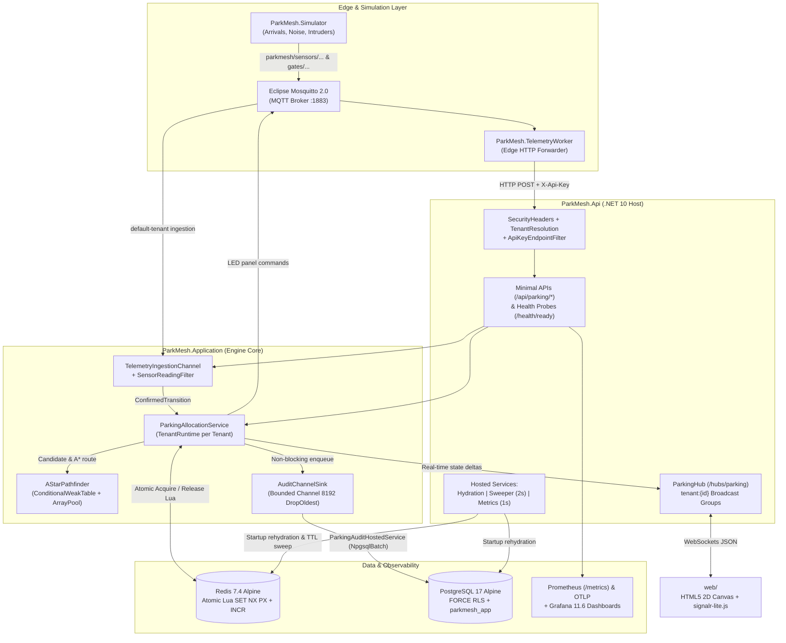
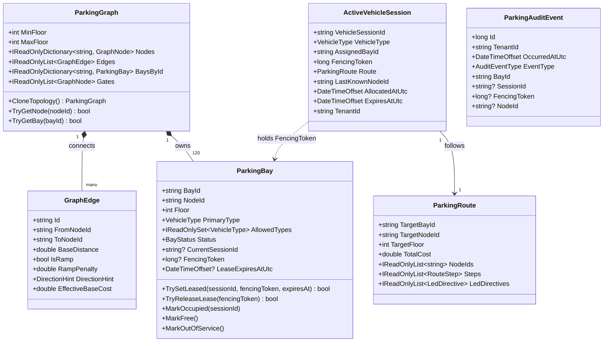
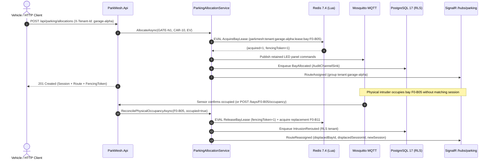
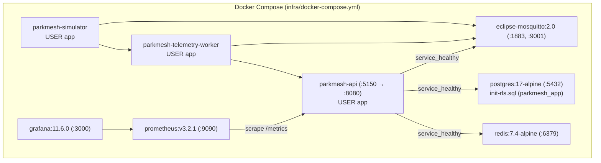
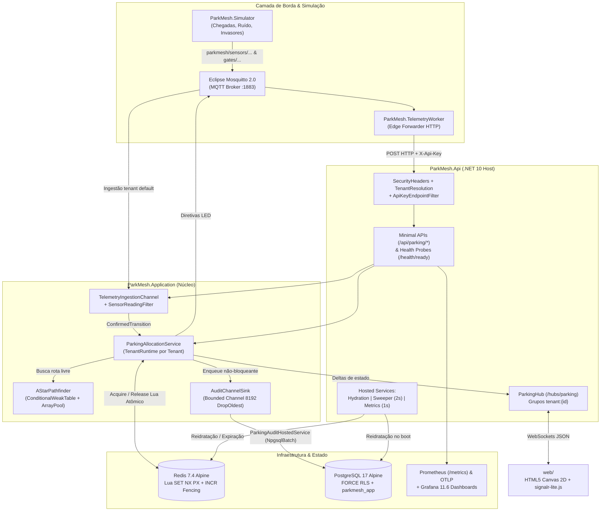
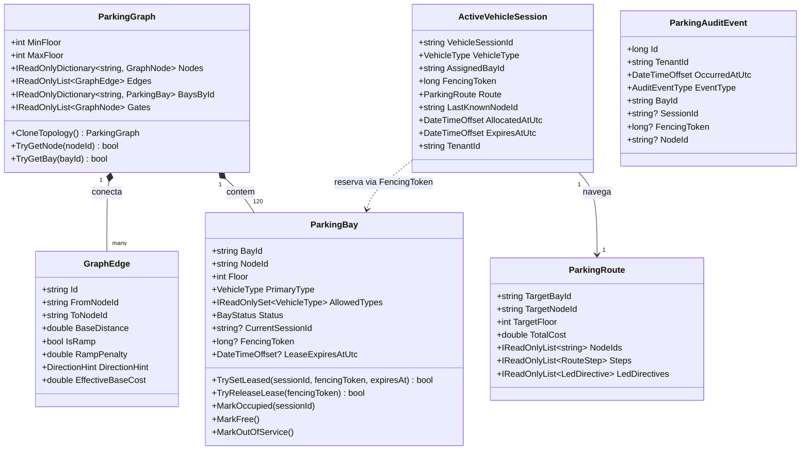
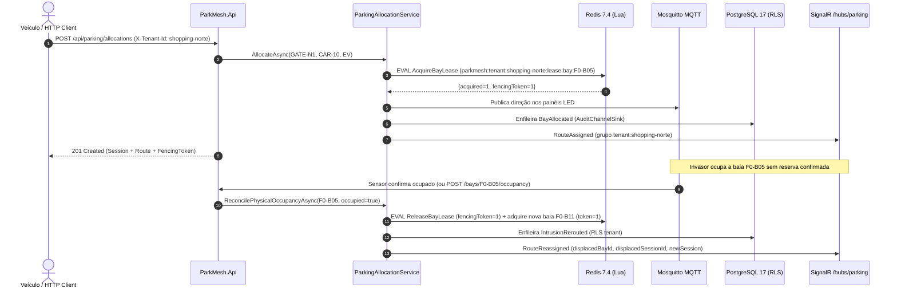

# ParkMesh API

<div align="center">

[](https://learn.microsoft.com/dotnet/csharp/)
[](https://dotnet.microsoft.com/)
[](https://dotnet.microsoft.com/apps/aspnet)
[](https://redis.io/)
[](https://www.postgresql.org/)
[](https://mosquitto.org/)
[](https://dotnet.microsoft.com/apps/aspnet/signalr)
[](https://opentelemetry.io/)
[](https://www.docker.com/)
[](#en-16-testing)
[](#en-23-slos)
[](https://github.com/DevYuriVieira/parkmesh/actions/workflows/ci.yml)

**Smart Parking Routing, Atomic Lease Coordination & Multi-Tenant Telemetry Engine**<br>
*A modular-monolith .NET 10 engine combining multi-floor A\* pathfinding, Redis Lua fencing tokens, MQTT edge debounce, fail-closed PostgreSQL 17 Row-Level Security, OpenTelemetry instrumentation, and real-time SignalR deltas.*

[🇺🇸 English](#-english) &nbsp;•&nbsp; [🇧🇷 Português](#-português)

</div>

---

<a name="-english"></a>
# 🇺🇸 English

## Executive Engineering Summary

| Area | ParkMesh Implementation |
|---|---|
| **Architecture** | Modular Monolith (`ParkMesh.Domain → Application → Infrastructure → Api`) + Dedicated Edge Workers (`TelemetryWorker`, `Simulator`) |
| **Runtime & Platform** | .NET 10.0 (`C# 14`, `LangVersion=latest`), `Nullable=enable`, `TreatWarningsAsErrors=true`, `Directory.Packages.props` (CPM) |
| **Graph Routing Engine** | 3-floor weighted directed graph (`0..2`, `120` bays, helical ramps) powered by single-pass indexed `AStarPathfinder` (`ConditionalWeakTable`, `ArrayPool<T>`, `[ThreadStatic]`) |
| **Distributed Lease Coordination** | Redis 7.4 atomic Lua scripts (`LuaScripts.AcquireBayLease`, `ReleaseBayLease`) with `SET ... PX` TTL and **monotonic fencing tokens** (`INCR`), plus `InMemoryBayLeaseManager` locally |
| **Consistency & Contention** | Idempotent session retries (`409 Conflict` on mismatched parameters), multi-round contention replanning under parallel arrivals, and self-healing intrusion rerouting (`IntrusionRerouted`) |
| **Persistence & Audit Outbox** | Non-blocking bounded channel outbox (`AuditChannelSink`, capacity `8192`, `DropOldest` + full shutdown drain) batching via `NpgsqlBatch` into PostgreSQL 17 |
| **Multi-Tenancy & Isolation** | Tenant = isolated logical garage (`TenantRuntime` per tenant + Redis key prefix `parkmesh:tenant:{id}:...` + PostgreSQL **`ENABLE`/`FORCE ROW LEVEL SECURITY`** + SignalR `tenant:{id}` groups) |
| **Telemetry & Anti-Flapping** | MQTT (`MQTTnet 4.3.7` / Mosquitto 2.0) and HTTP ingestion via bounded `TelemetryIngestionChannel` (`DropOldest`) + per-`(tenant, bay)` stability debounce (`SensorReadingFilter`) |
| **Real-Time Deltas & 2D Canvas** | SignalR (`/hubs/parking`) pushing `RouteAssigned`, `RouteReassigned`, `BayStateChanged`, `VehicleMoved`, `LedPanelUpdated`, and `MetricsTick` to zero-build HTML5 Canvas UI (`web/`) |
| **Edge Security & Fail-Closed Boot** | Outside `Development`, startup fails if `Security:ApiKey` is empty (unless `AllowUnauthenticatedProduction=true`) or `Security:AllowedTenants` is empty/invalid; constant-time SHA-256 `X-Api-Key`; chaos routes unmapped by default |
| **Rehydration & Fault Recovery** | `GarageStateHydrationHostedService` restores Postgres physical/maintenance state + Redis leases across `default` and `AllowedTenants` prior to `/health/ready`; `2s` lease expiration sweeper |
| **Observability & Probes** | OpenTelemetry (`Meter("ParkMesh.Engine")`, `ActivitySource("ParkMesh.Engine")`), `SlidingLatencyWindow` (P50/P95/P99), Prometheus `/metrics`, Grafana 11.6, `/openapi/v1.json`, `/health`, `/health/live`, `/health/ready` |
| **Automated Testing** | **105 automated tests** (`71` unit + `26` in-process API/SignalR/security/fault-injection integration + `8` Testcontainers Redis `7.4-alpine` & PostgreSQL `17-alpine` RLS) |
| **Containerization & CI** | Multi-stage Dockerfiles running as non-root `USER app` + GitHub Actions validating Compose, `UID != 0` runtime smoke test, Cobertura coverage summary, and SLO gate |
| **Capacity & SLO Engineering** | `--load` harness (`6,847.9 req/s`, `P95=5.33 ms`, `P99=67.99 ms`, `0` conflicts/errors) + `--capacity` memory probe (`~97.52–97.55 KiB`/tenant; practical budget `~2,500` active tenants in `512 MiB`) |

---

## Table of Contents

<details open>
<summary><b>Click to expand / collapse full table of contents</b></summary>

### Part I: Strategic Architecture & Domain Foundations
- [1. Overview](#en-1-overview)
- [2. Core Capabilities](#en-2-capabilities)
- [3. System Architecture](#en-3-system-architecture)
- [4. Clean Architecture & Modular Monolith](#en-4-clean-architecture)
- [5. Domain Model](#en-5-domain-model)
- [6. Business Rules, Invariants & Consistency](#en-6-business-rules)

### Part II: Atomic Leases, Audit Outbox, MQTT & Real-Time Streaming
- [7. Redis Atomic Lua Leases & PostgreSQL 17 FORCE RLS](#en-7-redis-postgres)
- [8. Concurrency Control, Multi-Tenant Isolation & Hot-Path Pooling](#en-8-concurrency)
- [9. Asynchronous Audit Outbox & Bounded Channel Backpressure](#en-9-outbox)
- [10. MQTT Edge Telemetry & SignalR Real-Time Delta Protocol](#en-10-mqtt-signalr)
- [11. Failure Scenarios Matrix](#en-11-failure-scenarios)

### Part III: API Surface, Security, Scope Limits & Observability
- [12. REST API Endpoints Inventory & cURL Examples](#en-12-endpoints)
- [13. Security Model, Edge Hardening & Known Scope Limits](#en-13-security)
- [14. Observability, OpenTelemetry & Health Probes](#en-14-observability)
- [15. Repository Structure](#en-15-structure)

### Part IV: Quality Gates, Containers, Operations, SLOs & Capacity
- [16. Automated Testing Strategy & CI Pipeline](#en-16-testing)
- [17. Containerized Environment (Docker & Compose)](#en-17-docker)
- [18. Technology Stack](#en-18-stack)
- [19. Getting Started & Execution Guide](#en-19-getting-started)
- [20. Configuration & Environment Variables](#en-20-configuration)
- [21. Architectural Decisions Fundamented & Deliberate Scope](#en-21-decisions)
- [22. Architecture Decision Records (ADRs) & Operational Docs](#en-22-adrs)
- [23. Service Level Objectives (SLOs), Capacity Engineering & Benchmarks](#en-23-slos)
- [24. Technical Audit & Quality Gate](#en-24-audit)
- [25. Author](#en-25-author)

</details>

---

<a id="en-1-overview"></a>
## 1. Overview

**ParkMesh** is a smart parking routing, distributed bay allocation, and multi-tenant telemetry engine built with **.NET 10 / C# 14**, engineered to demonstrate deterministic concurrency control, sub-millisecond graph routing, and operational resilience under physical and network stress.

Real-world automated multi-floor garages break naive CRUD backends across four core failure modes:
- **Reservation Race Conditions (Double-Booking):** Simultaneous vehicle arrivals across multiple entry gates race for the closest compatible free bay. ParkMesh eliminates double-booking by combining per-tenant synchronization locks with atomic Redis Lua scripts and **monotonic fencing tokens**, ensuring only one winner secures a bay and stale release requests fail safely.
- **Ultrasonic Sensor Flapping:** Pedestrian crossings, acoustic reflections, and MQTT packet jitter cause spurious physical occupancy flips. ParkMesh bounds intake memory with `Channel<T>` (`DropOldest`) and enforces temporal + sample stability (`MinConsecutiveReadings` and `StabilityWindowMs`) before confirming state changes.
- **Physical Intrusions & Dynamic Topology Changes:** When an unbooked driver parks in a leased bay — or an operator puts a bay `OutOfService` — the engine atomically revokes the displaced lease via its fencing token, removes stale corridor congestion, computes a fresh A\* path from the legitimate driver's `LastKnownNodeId`, and emits `RouteReassigned` deltas immediately.
- **Audit I/O Decoupling & Multi-Tenant Isolation:** Relational persistence runs off the allocation hot path via a bounded non-blocking outbox (`AuditChannelSink → NpgsqlBatch`), while each tenant (`X-Tenant-Id`) operates an isolated logical garage across memory, Redis keyspaces, PostgreSQL RLS, and SignalR groups.

---

<a id="en-2-capabilities"></a>
## 2. Core Capabilities

- **Multi-Floor Weighted Directed Graph (`ParkingGraph` & `StandardTopologyFactory`):** Models `3` floors (`0..2`), `120` bays (`40` per floor), entry gates (`GATE-N1`, `GATE-S1`), directional lane intersections, helical inter-floor ramps with penalties, and vehicle constraints (`Standard`, `EV`, `SUV`, `Pcd`, `Moto`).
- **Single-Pass Multi-Target & A\* Search (`AStarPathfinder`):** Runs a dense-indexed multi-target Dijkstra sweep with sliding k-th best cutoff for candidate bay ranking alongside admissible Euclidean A\* routing incorporating live `IEdgeCongestionTracker` weights.
- **Full Lease & Session Lifecycle (`ParkingAllocationService`):**
  - Idempotent retries for matching `(TenantId, VehicleSessionId)` requests and `409 Conflict` rejection on mismatched gate/vehicle parameters;
  - Multi-round contention replanning when parallel callers claim a candidate bay mid-allocation;
  - Node-by-node progress tracking (`UpdateVehicleProgressAsync`), physical intrusion rerouting, fencing-validated lease release (`DELETE`), and maintenance toggling (`PATCH .../maintenance`).
- **Edge Telemetry & Anti-Flapping (`TelemetryIngestionChannel` & `SensorReadingFilter`):** Deduplicates out-of-order sequence numbers per `(tenant, bay)` (`StaleSequence`) and requires consecutive stable readings across `StabilityWindowMs` before emitting `ConfirmedTransition`.
- **Edge Workers (`ParkMesh.Simulator` & `ParkMesh.TelemetryWorker`):** Simulate concurrent gate fleets, ultrasonic noise, and physical intruders over Eclipse Mosquitto + REST.

---

<a id="en-3-system-architecture"></a>
## 3. System Architecture

The engine separates its sub-millisecond allocation and realtime path (in-memory graph + Redis Lua + SignalR) from asynchronous MQTT edge ingestion and durable PostgreSQL audit batching:



---

<a id="en-4-clean-architecture"></a>
## 4. Clean Architecture & Modular Monolith

Dependencies point strictly inward per [ADR 0001](docs/adr/0001-modular-monolith-over-microservices.md), keeping routing and lease orchestration inside a single process without cross-service serialization hops:

```text
   ┌──────────────────────────────────────────────────────────┐
   │  ParkMesh.Api / ParkMesh.TelemetryWorker / Simulator     │
   └─────────────────────────┬────────────────┬───────────────┘
                             │                │
                             │      ┌─────────▼────────────────┐
                             │      │ ParkMesh.Infrastructure  │
                             │      └─────────┬────────────────┘
                             ▼                ▼
   ┌──────────────────────────────────────────────────────────┐
   │                   ParkMesh.Application                   │
   └──────────────────────────────┬───────────────────────────┘
                                  │
   ┌──────────────────────────────▼───────────────────────────┐
   │                     ParkMesh.Domain                      │  ◄── ZERO external dependencies
   └──────────────────────────────────────────────────────────┘
```

- **`ParkMesh.Domain`:** Directed graph primitives (`ParkingGraph`, `GraphNode`, `GraphEdge`), bay state machine (`ParkingBay`), route records (`ParkingRoute`, `RouteStep`, `LedDirective`), and `StandardTopologyFactory`. Zero NuGet dependencies.
- **`ParkMesh.Application`:** Allocation orchestrator (`ParkingAllocationService`), pathfinder (`AStarPathfinder`), bounded `Channel<T>` pipelines (`TelemetryIngestionChannel`, `AuditChannelSink`), async tenant scoping (`AsyncLocalTenantContext`, `TenantIdValidator`), and `EngineMetricsRecorder`.
- **`ParkMesh.Infrastructure`:** Redis Lua lease manager (`RedisBayLeaseManager`, `InMemoryBayLeaseManager`), PostgreSQL RLS outbox (`PostgresParkingAuditStore`, `InMemoryParkingAuditStore`, `ParkingAuditHostedService`), and MQTTnet client/publisher (`MqttConnectionManager`, `MqttTelemetryHostedService`, `MqttLedPanelPublisher`).
- **`ParkMesh.Api`:** Minimal API surface, `ParkingHub`, security middleware/filters, per-tenant chaos rate limiting, background workers, and static serving of `web/`.
- **`ParkMesh.TelemetryWorker` & `ParkMesh.Simulator`:** Isolated edge worker processes interacting over MQTT and REST.

---

<a id="en-5-domain-model"></a>
## 5. Domain Model



---

<a id="en-6-business-rules"></a>
## 6. Business Rules, Invariants & Consistency

ParkMesh enforces invariants across two complementary layers:

```text
Incoming HTTP Request / Confirmed Sensor Transition
       ↓
[ TenantRuntime (StateLock + Cloned Graph + ParkingBay) ] ── State machine & monotonic fencing check
       ↓
[ Redis Lua (SET NX PX + INCR) / PostgreSQL FORCE RLS ]   ── Atomic lease exclusion & RLS isolation
```

1. **Strict Monotonic Fencing Tokens:** `ParkingBay.TrySetLeased` rejects any token with `fencingToken <= FencingToken.Value`, while Redis increments the bay fence counter atomically (`INCR`).
2. **Idempotent Retry vs Parameter Conflict:** Repeating `POST /api/parking/allocations` with identical `(TenantId, VehicleSessionId, GateId, VehicleType)` while leased returns the existing session cleanly; mismatched gate or vehicle type returns `409 Conflict`.
3. **Multi-Round Contention Replanning:** When parallel workers race on the same ranked candidate, `ParkingAllocationService` records `ContentionRetriesTotal` and retries the next best bay returned by A\*.
4. **Intrusion Detection & Self-Healing Reroute (`IntrusionRerouted`):** Receiving `occupied: true` on a `Leased` bay with a non-matching session transitions the bay to `Occupied`, revokes the lease in Redis using its fencing token, reroutes the legitimate vehicle from `LastKnownNodeId`, and emits `RouteReassigned`.
5. **Safe Bay Maintenance (`OutOfService`):** Setting maintenance via `PATCH .../maintenance` revokes any active lease, allocates a replacement bay when available, and excludes the bay from future routing until restored.

---

<a id="en-7-redis-postgres"></a>
## 7. Redis Atomic Lua Leases & PostgreSQL 17 FORCE RLS

### Redis Lua Scripts (`src/ParkMesh.Infrastructure/Redis/LuaScripts.cs`)

Lease checks, fencing counter increment, and TTL assignment run inside one atomic Lua execution:

```lua
-- LuaScripts.AcquireBayLease
if redis.call("EXISTS", KEYS[1]) == 1 then
    return {0, 0}
end

local token = redis.call("INCR", KEYS[2])
local payload = ARGV[1] .. ":" .. tostring(token)
redis.call("SET", KEYS[1], payload, "PX", tonumber(ARGV[2]))
return {1, token}
```

```lua
-- LuaScripts.ReleaseBayLease (only deletes if stored fencing suffix matches)
local current = redis.call("GET", KEYS[1])
if not current then
    return 0
end

local expectedSuffix = ":" .. ARGV[1]
if string.sub(current, -string.len(expectedSuffix)) == expectedSuffix then
    redis.call("DEL", KEYS[1])
    return 1
end

return 0
```

- Tenant Redis namespaces (`RedisBayLeaseManager`): `{KeyPrefix}:lease:bay:{bayId}` / `fence:bay:{bayId}` for `default`, and `{KeyPrefix}:tenant:{tenantId}:lease:bay:{bayId}` / `fence:bay:{bayId}` for non-default tenants.

### PostgreSQL 17 Fail-Closed Row-Level Security (`PostgresParkingAuditStore.cs` & `infra/postgres/init-rls.sql`)

```sql
CREATE TABLE IF NOT EXISTS parking_audit_events (
    id BIGSERIAL PRIMARY KEY,
    tenant_id TEXT NOT NULL DEFAULT 'default',
    occurred_at_utc TIMESTAMPTZ NOT NULL,
    event_type TEXT NOT NULL,
    bay_id TEXT NOT NULL,
    session_id TEXT NULL,
    fencing_token BIGINT NULL,
    vehicle_type TEXT NULL,
    node_id TEXT NULL,
    details TEXT NULL
);

ALTER TABLE parking_audit_events ENABLE ROW LEVEL SECURITY;
ALTER TABLE parking_audit_events FORCE ROW LEVEL SECURITY;

DROP POLICY IF EXISTS parking_audit_tenant_isolation ON parking_audit_events;
CREATE POLICY parking_audit_tenant_isolation ON parking_audit_events
    FOR ALL
    USING (tenant_id = NULLIF(current_setting('app.current_tenant', true), ''))
    WITH CHECK (tenant_id = NULLIF(current_setting('app.current_tenant', true), ''));
```

- Every read and batch insert executes inside a transaction running `SELECT set_config('app.current_tenant', @tenant_id, true)`.
- When `Postgres:AppRole` is configured (e.g., `parkmesh_app` provisioned with `NOSUPERUSER NOBYPASSRLS` in `infra/postgres/init-rls.sql`), data-plane transactions invoke `SET LOCAL ROLE`, enforcing fail-closed `SQLSTATE 42501` denial on unscoped or cross-tenant writes — verified against Testcontainers PostgreSQL 17 in `PostgresAuditStoreIntegrationTests`.

---

<a id="en-8-concurrency"></a>
## 8. Concurrency Control, Multi-Tenant Isolation & Hot-Path Pooling

- **`TenantRuntime` Isolation (`ParkingAllocationService`):**
  - `_tenants` (`ConcurrentDictionary<string, TenantRuntime>`) maps each tenant to a cloned 120-bay `ParkingGraph` (`CloneTopology()`), dedicated `IEdgeCongestionTracker`, and `Lock` (`StateLock`), keying active sessions by `(TenantId, VehicleSessionId)`.
- **Low-Allocation Pathfinding (`AStarPathfinder`):**
  - Compiles flat dense graph arrays once per `ParkingGraph` instance via `ConditionalWeakTable<ParkingGraph, CompiledTopology>`;
  - Rents scratch arrays (`gScore`, `closed`, `prevNode`, `prevEdge`, `prevCost`, congestion) from `ArrayPool<T>.Shared` alongside `[ThreadStatic]` priority queues and lists, cutting standard 15-candidate search cost to `5.90 us` / `11,728 B` allocated (down from ~`689.2 us` / ~`847 KB`).

---

<a id="en-9-outbox"></a>
## 9. Asynchronous Audit Outbox & Bounded Channel Backpressure

To keep allocation and occupancy transitions independent of synchronous SQL round-trips:

1. **Non-Blocking Enqueue (`AuditChannelSink`):** Backed by `Channel.CreateBounded<ParkingAuditEvent>(capacity: 8192)` with `BoundedChannelFullMode.DropOldest`, carrying the active `ITenantContext.CurrentTenantId` and incrementing `DroppedCount` (exposed via `GET /api/parking/audit`) if saturated.
2. **Batch Flush & Shutdown Drain (`ParkingAuditHostedService`):** Reads batches up to `64` items, persists per-tenant groups atomically via `NpgsqlBatch`, and drains remaining buffered events on graceful shutdown (`finally`).
3. **Bounded Telemetry Channels:** `TelemetryIngestionChannel` (default `10,000`) and `_gateChannel` in `MqttTelemetryHostedService` (`1,000`) use `DropOldest` to bound heap usage during sensor bursts.

> [!NOTE]
> **Explicit PostgreSQL outage durability trade-off (`docs/RUNBOOK.md`):** In `ParkingAuditHostedService.FlushAsync`, when `_store.RecordBatchAsync` throws during a database outage, the worker logs the failure and clears the batch (`batch.Clear()`) rather than retrying indefinitely or blocking live bay allocations.

---

<a id="en-10-mqtt-signalr"></a>
## 10. MQTT Edge Telemetry & SignalR Real-Time Delta Protocol

### End-to-End Allocation, Intrusion & Reroute Flow



### MQTT Topics (`MqttTopics`)

| Topic Pattern | Direction | Payload / Role | Tenant Scope |
|---|---|---|---|
| `parkmesh/sensors/{floor}/{bayId}/state` | Inbound (`SensorsWildcard`: `parkmesh/sensors/+/+/state`) | `BaySensorReading` (ultrasonic telemetry + debounce) | Strictly **`default`** (payload `TenantId` stripped on MQTT intake) |
| `parkmesh/gates/{gateId}/admitted` | Inbound (`GatesWildcard`: `parkmesh/gates/+/admitted`) | `VehicleAdmittedEvent` (gate admission trigger) | Strictly **`default`** |
| `parkmesh/panels/{panelId}/direction` | Outbound (Retained QoS 1) | `LedPanelCommand` (`Straight`, `Left`, `Right`, `UpRamp`, `DownRamp`, `Arrive`) | Physical LED guidance |

### SignalR Hub (`/hubs/parking`)

- **Client-invoked methods:**
  - `GetParkingSnapshot()`: returns full graph geometry, floors, gates, active sessions, bay states, LED states, and metrics snapshot for the connection's tenant.
  - `SubscribeTenant(string tenantId)`: validates `TenantIdValidator` and `Security:AllowedTenants`, moves the connection into group `tenant:{id}`, and returns the target tenant's initial snapshot.
- **Server-pushed events per `tenant:{id}`:** `RouteAssigned`, `RouteReassigned`, `BayStateChanged`, `VehicleMoved`, `LedPanelUpdated`, and `1s` `MetricsTick`.
- **Visual Dashboard (`web/`):** Zero-build HTML5 2D Canvas simulator (`app.js` + `signalr-lite.js`) with multi-floor rendering, live tenant switcher (clearing `state.ledPanels` on switch), Auto-Demo mode, and chaos triggers.

---

<a id="en-11-failure-scenarios"></a>
## 11. Failure Scenarios Matrix

Each scenario below distinguishes **automated test coverage** from **code-derived behavior not yet chaos-tested across separate live containers** (documented in [`docs/RUNBOOK.md`](docs/RUNBOOK.md)):

| Failure Scenario | Expected System Behavior | Verification Evidence |
|---|---|---|
| **Redis outage / timeout** | `AllocateAsync` aborts before mutating local `ParkingGraph` (no phantom leases); `/health/ready` returns `503 degraded`. | **Automated:** `AllocateAsync_WhenLeaseStoreThrowsOutageException_DoesNotLeavePhantomLocalLeaseOrSession`, `HealthReady_Returns503Degraded_WhenLeaseStoreOrAuditStoreFailsConnectivity`, and `RedisBayLeaseManagerIntegrationTests`. |
| **PostgreSQL outage** | `/health/ready` degrades to `503`; hot-path allocations remain fast; failed audit batches in `FlushAsync` are logged and cleared (`batch.Clear()`). | **Automated:** `ParkingAuditHostedService_SurvivesTransientStoreFailureAndPersistsSubsequentBatch` and `PostgresAuditStoreIntegrationTests`. Live pool socket reconnect across container restarts is *code-derived*. |
| **Mosquitto broker unreachable** | `MqttConnectionManager.EnsureConnectedAsync` returns `false` without throwing; HTTP `POST /api/parking/telemetry/readings` stays operational. | **Automated:** `MqttConnectionManager_EnsureConnectedAsync_ReturnsFalseWhenBrokerUnreachable` + CI container smoke test with `Mqtt__Enabled=false`. Live broker reconnect is *code-derived*. |
| **`ParkMesh.Api` restart mid-operation** | `GarageStateHydrationHostedService` replays Postgres physical states and active Redis leases across `default` + `AllowedTenants` before flipping `/health/ready` to `200 OK`. | **Automated:** `StateHydrationTests` and `RedisBayLeaseManagerIntegrationTests.MultiTenantContext_IsolatesRedisLeaseKeysAndSupportsMultiTenantRehydration`. |
| **50-way parallel bay contention** | Exactly one caller secures the target bay lease; parallel callers receive conflict/replanning with unique monotonic fencing tokens. | **Automated:** `TryAcquireLeaseAsync_Under50WayContention_AllowsExactlyOneWinner` and `ParallelAllocationService_WithRealRedis_NeverDoubleBooks`. |
| **Stale fencing token release** | Lua `ReleaseBayLease` returns `0` on suffix mismatch; API rejects with `409 Conflict`. | **Automated:** `TryAcquireAndRelease_EnforcesAtomicLockAndMonotonicFencingTokens` + API integration tests. |

---

<a id="en-12-endpoints"></a>
## 12. REST API Endpoints Inventory & cURL Examples

All `/api/parking/*` routes are guarded by `ApiKeyEndpointFilter` (`X-Api-Key` when configured) and scoped by `TenantResolutionMiddleware` (`X-Tenant-Id`, default `"default"`):

### State, Topology & Audit
| Method | Route | Purpose | Success |
|:---:|:---|:---|:---:|
| `GET` | `/` | Serves the 2D multi-floor HTML5 Canvas simulator (`web/index.html`) | `200 OK` |
| `GET` | `/api/parking/topology` | Returns graph nodes, edges, bays, and gates (`ApiKeyEndpointFilter`) | `200 OK` |
| `GET` | `/api/parking/snapshot` | Full tenant graph, bays, active sessions, LEDs, and metrics bootstrap | `200 OK` |
| `GET` | `/api/parking/bays` | Lists bays with optional `floor`, `status`, and `vehicleType` filters | `200 OK` |
| `GET` | `/api/parking/sessions` | Active vehicle sessions scoped to the current tenant | `200 OK` |
| `GET` | `/api/parking/audit?limit=50` | Recent persisted audit events (via RLS) + sink `droppedCount` | `200 OK` |

### Allocation, Lifecycle & Telemetry
| Method | Route | Purpose | Success / Error |
|:---:|:---|:---|:---:|
| `POST` | `/api/parking/allocations` | Computes optimal A\* route and acquires Redis Lua bay lease | `201` / `409` |
| `DELETE` | `/api/parking/allocations/{bayId}?fencingToken=...` | Releases bay lease after fencing token validation | `204` / `409` |
| `POST` | `/api/parking/sessions/{sessionId}/progress` | Updates `LastKnownNodeId` along active vehicle route | `200` / `404` |
| `POST` | `/api/parking/bays/{bayId}/occupancy` | Confirms physical occupied/vacated state (reroutes on intrusion) | `200` / `404` |
| `PATCH` | `/api/parking/bays/{bayId}/maintenance` | Toggles `OutOfService` / `Free` and displaces any active lease | `200` / `404` |
| `POST` | `/api/parking/telemetry/readings` | Enqueues raw HTTP sensor reading stamped with validated `ITenantContext` | `202` / `503` |
| `GET` | `/api/parking/telemetry/metrics` | Returns bounded telemetry ingestion channel counters | `200 OK` |

### Chaos (Unmapped outside `Development` unless `EnableChaosEndpoints=true`) & Observability
| Method | Route | Purpose | Response |
|:---:|:---|:---|:---:|
| `POST` | `/api/parking/chaos/intruder` | Injects intrusion on a leased bay in the current tenant (`"chaos"` rate limiter) | `200` / `409` / `429` |
| `POST` | `/api/parking/chaos/burst?count=25` | Fires `1..60` parallel vehicle allocations across entry gates | `200` / `429` |
| `GET` | `/api/parking/metrics` | Tenant bay counts + process-global latency/counter snapshot | `200 OK` |
| `GET` | `/metrics` | OpenTelemetry Prometheus scrape endpoint | `200 OK` |
| `GET` | `/openapi/v1.json` | Native `.NET 10` OpenAPI specification document | `200 OK` |
| `GET` | `/health` | Basic Kestrel liveness response | `200 OK` |
| `GET` | `/health/live` | Process liveness probe | `200 OK` |
| `GET` | `/health/ready` | Readiness probe (Redis ping + Postgres connectivity + `IsHydrated`) | `200` / `503` |
| `WS` | `/hubs/parking` | SignalR JSON WebSocket hub (`?tenantId=...` or `X-Tenant-Id`) | WebSocket |

### Quick cURL Examples

```bash
# 1. Allocate an EV bay from North Gate in tenant "garage-alpha"
curl -X POST "http://localhost:5150/api/parking/allocations" \
  -H "Content-Type: application/json" \
  -H "X-Tenant-Id: garage-alpha" \
  -H "X-Api-Key: dev-secret-if-configured" \
  -d '{"gateId":"GATE-N1","vehicleSessionId":"CAR-101","vehicleType":"EV","leaseSeconds":90}'

# 2. Report physical bay intrusion (triggers revocation + automatic RouteReassigned delta)
curl -X POST "http://localhost:5150/api/parking/bays/F0-B05/occupancy" \
  -H "Content-Type: application/json" \
  -H "X-Tenant-Id: garage-alpha" \
  -H "X-Api-Key: dev-secret-if-configured" \
  -d '{"occupied":true,"occupantSessionId":"INTRUDER-99"}'

# 3. Release bay lease using its fencingToken
curl -X DELETE "http://localhost:5150/api/parking/allocations/F0-B05?fencingToken=1" \
  -H "X-Tenant-Id: garage-alpha" \
  -H "X-Api-Key: dev-secret-if-configured"
```

---

<a id="en-13-security"></a>
## 13. Security Model, Edge Hardening & Known Scope Limits

Security guarantees and accepted PoC boundaries are documented in [`docs/THREAT_MODEL.md`](docs/THREAT_MODEL.md) and [`docs/adr/0008-tenant-as-isolated-logical-garage.md`](docs/adr/0008-tenant-as-isolated-logical-garage.md):

- **Production Fail-Closed Startup (`Program.cs`):**
  - Outside `Development`, startup fails if `Security:ApiKey` is empty (unless `Security:AllowUnauthenticatedProduction=true`), if `Security:AllowedTenants` is empty, or if any configured tenant fails `TenantIdValidator.IsValid`. Because each materialized tenant retains ~`97.5 KiB` in memory, requiring an explicit allowlist prevents unbounded heap growth.
  - `/api/parking/chaos/*` routes remain completely unmapped outside `Development` unless `Security:EnableChaosEndpoints=true`, and are rate-limited per tenant (`chaos` Fixed Window).
- **Constant-Time Verification & HTTP Headers (`SecurityOptions.cs`):**
  - `ApiKeyValidator.IsAuthorized` hashes and compares `X-Api-Key` using SHA-256 + `CryptographicOperations.FixedTimeEquals` across every `/api/parking/*` route (including `/api/parking/topology`) and `/hubs/parking`.
  - `SecurityHeadersMiddleware` applies `X-Content-Type-Options: nosniff`, `X-Frame-Options: DENY`, `Referrer-Policy: no-referrer`, `X-Permitted-Cross-Domain-Policies: none`, `Permissions-Policy`, `Content-Security-Policy`, and enforces `MaxRequestBodyBytes` (`64 KiB`, `413 Payload Too Large`).
- **Tenant Identity, Telemetry Boundaries & Metric Scope (`PM-02`, `PM-08`):**
  - `X-Tenant-Id` is caller-declared and guarded by shared `Security:ApiKey` + `Security:AllowedTenants` rather than per-user JWT/OIDC claims; deploy upstream JWT/claim termination before untrusted multi-tenant ingress.
  - `POST /api/parking/telemetry/readings` stamps `TenantId` strictly from the validated header, while `SensorReadingFilter` normalizes blank tenant strings to `default` and keys debounce state by `(tenant, bay)`. **MQTT always targets `default`** because sensor topics carry no tenant metadata ([`docs/CONTRACT_VERSIONING.md`](docs/CONTRACT_VERSIONING.md)).
  - **Mixed `EngineMetricsSnapshot` scope (`PM-02`):** `TotalBays`, `FreeBays`, `LeasedBays`, `OccupiedBays`, `OutOfServiceBays`, and `ActiveSessions` are per-tenant, whereas `AllocationsTotal`, `ContentionRetriesTotal`, `ReroutesTotal`, `LeasesExpiredTotal`, `AStarLatency`, `RedisLeaseLatency`, and `Telemetry` are process-global counters/histograms.
  - **Idle tenant `MetricsTick` (`PM-08`):** `MetricsBroadcastHostedService` iterates `GetKnownTenants()`, so a raw `/hubs/parking?tenantId=...` WebSocket connection on an unmaterialized tenant receives no `1s` `MetricsTick` frames until an HTTP request, `GetParkingSnapshot()`, or `SubscribeTenant()` initializes its `TenantRuntime`.
  - **Static `web/` UI vs `ApiKey`:** The bundled Canvas dashboard has no login/API-key prompt, so `/api/*` and `/hubs/parking` calls return `401 Unauthorized` when `Security:ApiKey` is enabled.

---

<a id="en-14-observability"></a>
## 14. Observability, OpenTelemetry & Health Probes

- **Native OpenTelemetry (`EngineMetricsRecorder`):**
  - `Meter("ParkMesh.Engine")`: histograms `parkmesh.routing.astar.duration` & `parkmesh.lease.redis.duration` (`ms`) and counters `parkmesh.allocations.total`, `parkmesh.allocations.contention`, `parkmesh.reroutes.total`, and `parkmesh.leases.expired.total`.
  - `ActivitySource("ParkMesh.Engine")`: distributed spans across allocations (`parkmesh.allocate`), physical reconciliation, and `Npgsql.OpenTelemetry` SQL spans (OTLP export enabled via `OTEL_EXPORTER_OTLP_ENDPOINT`).
  - **Real-Time Percentiles (`SlidingLatencyWindow`):** `1024`-sample ring buffer powering P50/P95/P99 in `/api/parking/metrics` and SignalR `MetricsTick`.
  - **Prometheus & Grafana:** `/metrics` scraping endpoint with pre-configured provisioning in `infra/prometheus/` and `infra/grafana/`.
- **Health Probes:**
  - `/health` and `/health/live`: lightweight process liveness probes.
  - `/health/ready`: returns `200 OK` only when `StateHydrationTracker.IsHydrated`, `IBayLeaseManager.PingAsync()`, and `IParkingAuditStore.CheckConnectivityAsync()` all succeed; returns `503 Service Unavailable` (`status: "degraded"`) otherwise.

---

<a id="en-15-structure"></a>
## 15. Repository Structure

```text
ParkMesh/
├── .github/workflows/ci.yml            # CI: Build, Compose check, Docker build, USER app smoke, tests, Cobertura, SLO gate
├── .editorconfig                       # Consistent formatting and C# style configuration
├── Directory.Build.props               # net10.0, Nullable=enable, TreatWarningsAsErrors=true
├── Directory.Packages.props            # Central Package Management (CPM)
├── ParkMesh.sln                        # Unified .NET 10 solution
├── README.md                           # Full bilingual documentation (PT/EN)
├── benchmarks/
│   └── ParkMesh.Benchmarks/            # BenchmarkDotNet, LoadHarnessRunner (--slo), CapacityProbe (--capacity), slo-baseline.json
├── docs/
│   ├── ARCHITECTURE.md                 # System architecture blueprint
│   ├── CAPACITY.md                     # Measured per-tenant heap (~97.52 KiB) & load baseline
│   ├── CONTRACT_VERSIONING.md          # Additive vs breaking compatibility rules (HTTP, SignalR, MQTT, SQL RLS)
│   ├── RUNBOOK.md                      # SRE incident procedures: Redis, PostgreSQL, Mosquitto, Restart
│   ├── THREAT_MODEL.md                 # STRIDE assets, trust boundaries, abuse cases, accepted PoC scope
│   └── adr/                            # Architecture Decision Records 0001-0008
├── infra/
│   ├── docker-compose.yml              # Redis 7.4, Postgres 17, Mosquitto 2.0 (+ app, observability, full profiles)
│   ├── postgres/init-rls.sql           # Non-superuser parkmesh_app NOBYPASSRLS role script
│   ├── prometheus/ & grafana/          # Prometheus config & provisioned Grafana dashboard
│   └── k6/load-test.js                 # Optional multi-tenant k6 load test script
├── src/
│   ├── ParkMesh.Domain/                # Graph, bays, routes, enums, StandardTopologyFactory (zero dependencies)
│   ├── ParkMesh.Application/           # AStarPathfinder, ParkingAllocationService, channels, metrics, tenant context
│   ├── ParkMesh.Infrastructure/        # Redis Lua leases, Postgres RLS + NpgsqlBatch, MQTTnet, DI
│   ├── ParkMesh.Api/                   # Minimal APIs, SignalR Hub, Security/Tenant middleware, HostedServices, Dockerfiles
│   ├── ParkMesh.TelemetryWorker/       # MQTT sensor/gate edge forwarder worker
│   └── ParkMesh.Simulator/             # Vehicle arrival, ultrasonic chatter, and intruder simulator
├── tests/
│   ├── ParkMesh.UnitTests/             # 71 unit tests (domain, A*, debounce, outbox, hydration, RLS SQL, resilience, congestion, audit)
│   └── ParkMesh.IntegrationTests/      # 34 integration tests (26 in-process API/SignalR/security + 8 Testcontainers Redis/Postgres)
└── web/                                # Zero-build HTML5 2D Canvas UI (index.html, app.js, signalr-lite.js, styles.css)
```

---

<a id="en-16-testing"></a>
## 16. Automated Testing Strategy & CI Pipeline

ParkMesh maintains **105 automated tests** executed on every push/PR in [`ParkMesh CI`](.github/workflows/ci.yml):

| Suite / Stage | Count / Status | Technical Verification |
|---|---|---|
| `ParkMesh.UnitTests` | **71 passing** (`0` failed) | Graph invariants, edge validation & `CloneTopology()`, `InMemoryEdgeCongestionTracker` clamping, A\* heuristic & k-th cutoff, idempotent retries & contention replanning, lease TTL/monotonic fence & sweeper, planned park/depart occupancy lifecycle, `OutOfService` maintenance, `(tenant, bay)` debounce, bounded outbox drain/transient failure handling, `SecurityAndRlsTests`, query clamping & startup hydration |
| `ParkMesh.IntegrationTests` (No Docker) | **26 passing** (`0` failed) | Minimal API flows, OpenAPI `/openapi/v1.json`, `/health/ready` `503 degraded` fault injection, SignalR `tenant:{id}` isolation & live switching, security/CSP headers, `ApiKeyEndpointFilter` (including `/topology`), fail-closed startup outside `Development` |
| `ParkMesh.IntegrationTests` (Testcontainers Redis `7.4-alpine`) | **4 passing** (Linux CI) | Lua acquire/release with monotonic fencing tokens, 50-way race contention, 40 concurrent allocations without double-booking, multi-tenant Redis key isolation and rehydration |
| `ParkMesh.IntegrationTests` (Testcontainers Postgres `17-alpine`) | **4 passing** (Linux CI) | Schema initialization, `NpgsqlBatch` persistence, latest physical/maintenance replay, and `FORCE ROW LEVEL SECURITY` fail-closed enforcement (`SQLSTATE 42501`) under restricted `parkmesh_app` role / `Postgres:AppRole` |
| **Non-Root Container Smoke Test (`USER app`)** | Verified in CI | Boots `parkmesh-api` image via Docker Compose, asserts `id -u != 0`, and polls `/health/ready` until `200 OK` |
| **Code Coverage + Load SLO Gate** | Verified in CI | Cobertura unit + integration coverage summary published to `GITHUB_STEP_SUMMARY`, followed by `--load --slo benchmarks/ParkMesh.Benchmarks/slo-baseline.json` |

---

<a id="en-17-docker"></a>
## 17. Containerized Environment (Docker & Compose)

[`infra/docker-compose.yml`](infra/docker-compose.yml) supports running backing services standalone or together with application and observability profiles (`app`, `observability`, `full`):



- **Multi-Stage Non-Root Images:** All three Dockerfiles (`ParkMesh.Api`, `ParkMesh.TelemetryWorker`, `ParkMesh.Simulator`) compile on `dotnet/sdk:10.0`, publish to `dotnet/aspnet:10.0` / `dotnet/runtime:10.0`, and run under `USER app` (verified in CI with `id -u != 0`).
- **Local Demo Configuration Only:** `infra/docker-compose.yml` configures `ASPNETCORE_ENVIRONMENT=Development`, anonymous Mosquitto, and local credentials strictly for local demos.

---

<a id="en-18-stack"></a>
## 18. Technology Stack

| Component | Version in Repo | Architectural Role |
|---|---|---|
| **Language & Runtime** | C# 14 / .NET 10.0 | High-throughput engine with `TreatWarningsAsErrors` and native `Lock` |
| **Web & Realtime Framework** | ASP.NET Core 10 / SignalR | Minimal APIs, `IHubContext`, RateLimiter, OpenAPI 10.0.11 |
| **Lease Coordination** | Redis `7.4-alpine` / `StackExchange.Redis` `3.4.35` | Atomic Lua bay leases and monotonic fencing tokens |
| **Relational Persistence & RLS** | PostgreSQL `17-alpine` / `Npgsql` `10.0.3` | Batched audit log persistence and fail-closed `FORCE ROW LEVEL SECURITY` |
| **MQTT Broker & Client** | Eclipse Mosquitto `2.0` / `MQTTnet` `4.3.7.1207` | Edge telemetry ingestion and retained LED directional commands |
| **Observability** | OpenTelemetry `1.15.3` / Prometheus `v3.2.1` / Grafana `11.6.0` | `Meter`, `ActivitySource`, `/metrics` scraping, and dashboards |
| **Testing & Coverage** | xUnit `2.9.3` / Testcontainers `4.16.0` / Coverlet `6.0.4` | Unit, API/SignalR integration, and Testcontainers suites |
| **Benchmarks & Load** | BenchmarkDotNet `0.15.8` / k6 | Microbenchmarks, tenant heap probe, and CI load SLO gate |

---

<a id="en-19-getting-started"></a>
## 19. Getting Started & Execution Guide

### 1. Clone the Repository

```bash
git clone https://github.com/DevYuriVieira/parkmesh.git
cd parkmesh
```

### 2. Standalone Mode (Zero Docker Required)

When `ConnectionStrings:Redis` and `ConnectionStrings:Postgres` are empty (`appsettings.json`), `ParkMesh.Api` uses `InMemoryBayLeaseManager` and `InMemoryParkingAuditStore`:

```bash
dotnet run --project src/ParkMesh.Api
```

Open `http://localhost:5150` (or the printed listening URL) to launch the 2D HTML5 Canvas simulator (`/`).

### 3. Full Stack with Docker Compose

```bash
# Start Redis 7.4, PostgreSQL 17 (with init-rls.sql), and Mosquitto 2.0
docker compose -f infra/docker-compose.yml up -d

# OR launch the entire stack: API + Edge Workers + Prometheus (:9090) + Grafana (:3000)
docker compose -f infra/docker-compose.yml --profile full up -d --build
```

Run edge workers manually against a local `ParkMesh.Api`:

```bash
dotnet run --project src/ParkMesh.TelemetryWorker
dotnet run --project src/ParkMesh.Simulator
```

### 4. Run Tests, Load SLO Gate & Capacity Probe

```bash
# Build Release solution
dotnet build ParkMesh.sln -c Release

# 71 unit tests
dotnet test tests/ParkMesh.UnitTests/ParkMesh.UnitTests.csproj -c Release --no-build

# 26 integration tests without Docker
dotnet test tests/ParkMesh.IntegrationTests/ParkMesh.IntegrationTests.csproj -c Release --no-build \
  --filter "FullyQualifiedName!~PostgresAuditStoreIntegrationTests&FullyQualifiedName!~RedisBayLeaseManagerIntegrationTests"

# Full 34 integration tests (includes Testcontainers Redis & PostgreSQL; requires Docker)
dotnet test tests/ParkMesh.IntegrationTests/ParkMesh.IntegrationTests.csproj -c Release --no-build

# Concurrent HTTP + SignalR load harness with CI SLO gate check
dotnet run --project benchmarks/ParkMesh.Benchmarks -c Release --no-build -- \
  --load --concurrency 16 --requests 300 --slo benchmarks/ParkMesh.Benchmarks/slo-baseline.json

# Per-tenant memory capacity probe
dotnet run --project benchmarks/ParkMesh.Benchmarks -c Release --no-build -- --capacity --tenants 100

# BenchmarkDotNet microbenchmarks
dotnet run --project benchmarks/ParkMesh.Benchmarks -c Release --no-build -- --filter *

# Optional k6 load script against a running API
k6 run infra/k6/load-test.js
```

---

<a id="en-20-configuration"></a>
## 20. Configuration & Environment Variables

| Setting / Env Var (`__` in Docker) | Default (`appsettings.json`) | Purpose |
|---|---|---|
| `ASPNETCORE_ENVIRONMENT` | `Development` | Enables fail-closed `ApiKey` and `AllowedTenants` checks outside `Development` |
| `ConnectionStrings__Redis` | `""` | Redis connection string (falls back to `InMemoryBayLeaseManager` if empty) |
| `ConnectionStrings__Postgres` | `""` | PostgreSQL connection string (falls back to `InMemoryParkingAuditStore` if empty) |
| `Postgres__AppRole` | `""` | Non-superuser role applied via `SET LOCAL ROLE` (e.g., `parkmesh_app` in Compose) |
| `RedisLease__KeyPrefix` | `parkmesh` | Redis key prefix for lease and fencing counters |
| `Mqtt__Enabled` | `false` | Enables MQTT broker subscription and LED command publishing |
| `Mqtt__Host` / `Mqtt__Port` | `localhost` / `1883` | Eclipse Mosquitto broker host and port |
| `SensorDebounce__MinConsecutiveReadings` / `StabilityWindowMs` / `ChannelCapacity` | `2` / `1500` / `10000` | Anti-flapping debounce thresholds and bounded ingestion channel capacity |
| `Security__ApiKey` | `""` | `X-Api-Key` secret (required outside `Development` unless opt-out) |
| `Security__AllowedTenants` | `[]` | Tenant allowlist (required and validated outside `Development`) |
| `Security__AllowUnauthenticatedProduction` | `false` | Explicit opt-out if omitting `Security:ApiKey` outside `Development` |
| `Security__EnableChaosEndpoints` | `false` | Maps `/api/parking/chaos/*` outside `Development` when `true` |
| `Security__EnableRateLimiting` / `ChaosPermitLimit` / `ChaosWindowSeconds` | `true` / `30` / `10` | Per-tenant fixed-window rate limits for chaos endpoints |
| `OTEL_EXPORTER_OTLP_ENDPOINT` | *(empty)* | Optional OTLP exporter endpoint for OpenTelemetry traces and metrics |

---

<a id="en-21-decisions"></a>
## 21. Architectural Decisions Fundamented & Deliberate Scope

- **Why Modular Monolith over Microservices?** Splitting A\* routing and lease orchestration across network hops would introduce serialization latency on every vehicle arrival with no independent scaling benefit at this stage ([ADR 0001](docs/adr/0001-modular-monolith-over-microservices.md)).
- **Why Tenant as Isolated Logical Garage (`TenantRuntime`)?** Cloning the 120-bay graph per tenant (~`97.52 KiB`) eliminates cross-tenant state collisions in memory while preserving cache-local pathfinding ([ADR 0008](docs/adr/0008-tenant-as-isolated-logical-garage.md)).
- **Deliberately Out of Scope (Anti-Over-Engineering):** Kubernetes/Helm charts, Event Sourcing/MediatR, Apache Kafka replacing MQTT/`Channel<T>`, multi-pod SignalR backplanes, idle `TenantRuntime` LRU eviction (unneeded below ~`2,500` active tenants in `512 MiB`), and embedded OIDC token issuance. Explicit revisit triggers live in [ADR 0008](docs/adr/0008-tenant-as-isolated-logical-garage.md).

---

<a id="en-22-adrs"></a>
## 22. Architecture Decision Records (ADRs) & Operational Docs

| Document / ADR | Core Focus |
|---|---|
| [Architecture Blueprint](docs/ARCHITECTURE.md) | Subsystem responsibilities, routing, protocols, and hardening overview |
| [Threat Model](docs/THREAT_MODEL.md) | Critical assets, trust boundaries, abuse cases, and accepted PoC limits |
| [Operational Runbook](docs/RUNBOOK.md) | Incident playbooks: Redis, PostgreSQL, Mosquitto, and API Restart |
| [Capacity & SLO Baseline](docs/CAPACITY.md) | Reproducible per-tenant heap numbers and load SLO baseline |
| [Contract Versioning Policy](docs/CONTRACT_VERSIONING.md) | Additive vs breaking rules across HTTP, SignalR, MQTT, and SQL RLS |
| [ADR 0001](docs/adr/0001-modular-monolith-over-microservices.md) | Modular Monolith with Dedicated Edge Workers |
| [ADR 0002](docs/adr/0002-redis-lua-leases-with-fencing-tokens.md) | Atomic Redis Lua Leases with Monotonic Fencing Tokens |
| [ADR 0003](docs/adr/0003-multi-floor-astar-with-admissible-heuristic.md) | Multi-Floor A\* Pathfinding with Admissible Euclidean Heuristic |
| [ADR 0004](docs/adr/0004-bounded-channel-backpressure-and-anti-flapping.md) | Bounded Channel Backpressure and Anti-Flapping Debounce |
| [ADR 0005](docs/adr/0005-signalr-delta-protocol-and-zero-build-canvas.md) | SignalR Delta Protocol and Zero-Build HTML5 Canvas Simulator |
| [ADR 0006](docs/adr/0006-async-audit-outbox-and-lease-reconciliation.md) | Asynchronous Audit Outbox, Proactive Lease Reconciliation, and Hardening |
| [ADR 0007](docs/adr/0007-indexed-multi-target-routing-and-state-hydration.md) | Single-Pass Indexed Multi-Target Routing, Startup State Hydration, and Maintenance |
| [ADR 0008](docs/adr/0008-tenant-as-isolated-logical-garage.md) | Tenant as Isolated Logical Garage & Revisit Criteria |

---

<a id="en-23-slos"></a>
## 23. Service Level Objectives (SLOs), Capacity Engineering & Benchmarks

### Concurrent HTTP + SignalR Baseline & CI Gate (`LoadHarnessRunner` / `slo-baseline.json`)

Measured across **16 concurrent workers** executing **300 allocate/exit/reroute cycles** + **30 idempotent retries** (**1,230 HTTP requests**) and live SignalR delta frames in Release mode:

| Metric | Verified Run (`main` @ `4c1e097`) | Local Baseline Range (`CAPACITY.md`) | CI Regression Gate (`slo-baseline.json`) |
|---|---|---|---|
| **Throughput** | **`6,847.9 req/s`** (`179.6 ms`) | `5,411.4 – 7,068.3 req/s` | `>= 400.0 req/s` |
| **P50 Latency** | `0.49 ms` | `0.40 – 0.50 ms` | Informational |
| **P95 Latency** | `5.33 ms` | `5.30 – 6.98 ms` | `<= 120.0 ms` |
| **P99 Latency** | `67.99 ms` | `70.92 – 92.92 ms` | `<= 450.0 ms` |
| **Max Latency** | `93.01 ms` | `96.26 – 124.51 ms` | Informational |
| **SignalR Frames** | `529` JSON frames | `525 – 533` frames | `>= 100` frames |
| **Correctness** | `300 ok \| 30 retries \| 0 conflicts \| 0 errors` | `300 ok \| 30 retries \| 0 conflicts \| 0 errors` | `minOk=300`, `minIdemp=30`, `maxConflicts=0`, `maxErrors=0` |

> *Measurement note:* `--load` intentionally skips pre-warmup so tail latency captures JIT compilation and lazy `TenantRuntime` creation. Shared 2-vCPU CI runners (`ubuntu-latest`) apply threshold headroom while holding zero tolerance for conflicts and errors.

### Per-Tenant Memory Footprint (`CapacityProbe`)

Stabilized managed heap (`GC.GetTotalMemory(true)`) after provisioning `N` warmed `TenantRuntime` instances (`Allocate + A* + Release`):

| Tenant Count (`N`) | Baseline Heap | After Heap | Heap Delta | Avg Per Active Tenant | Raw `512 MiB` Extrapolation | Practical Budget (`<= 50%` headroom) |
|---:|---:|---:|---:|---:|---:|---:|
| `100` *(measured on `4c1e097`)* | `487.4 KiB` | `10,242.9 KiB` | `9,755.5 KiB` (`9.53 MiB`) | **`97.55 KiB`** (`99,896 B`) | `~5,374` tenants | **`~2,500` tenants** |
| `500` *(`docs/CAPACITY.md`)* | `487.4 KiB` | `49,253.5 KiB` | `48,766.0 KiB` (`47.62 MiB`) | **`97.53 KiB`** (`99,873 B`) | `~5,375` tenants | **`~2,500` tenants** |

### Core Hot-Path Microbenchmarks (`BenchmarkDotNet v0.15.8`, `.NET 10.0.11` — recorded historical baseline)

| Benchmark | Phase 4 Baseline | Recorded Mean | Recorded Allocated |
|---|---:|---:|---:|
| `AStar_Find15Candidates_Standard` | ~689.2 us (~847 KB) | `5.90 us` | `11,728 B` |
| `AStar_Find15Candidates_EV` | ~320.6 us (~409 KB) | `8.48 us` | `16,808 B` |
| `AllocateAndRelease_InMemory` | ~636.1 us (~892 KB) | `8.43 us` | `13,568 B` |
| `TelemetryFilter_EvaluateReading` | ~58.7 ns (72 B) | `64.53 ns` | `72 B` |
| `SlidingWindow_Compute1024Percentiles` | ~9.21 us (~8.1 KB) | `6.74 us` | `8,264 B` |

---

<a id="en-24-audit"></a>
## 24. Technical Audit & Quality Gate

- **Zero-Warning Build:** `dotnet build ParkMesh.sln -c Release --no-restore` passes with **0 warnings and 0 errors** (`TreatWarningsAsErrors=true`, `Nullable=enable`).
- **Passing `main` CI Pipeline (`ParkMesh CI`):** The `build-and-test` job succeeded on `ubuntu-latest`, verifying Compose validity, multi-stage image builds, non-root `USER app` container startup (`UID != 0` + `/health/ready` `200 OK`), 71 unit tests, 34 full integration tests including Testcontainers Redis and PostgreSQL 17 RLS, Cobertura coverage reporting, and the Load SLO Gate.
- **Honest Execution Scope Disclosure:** On Windows without a local Docker Desktop daemon running, all `71` unit tests, `26` non-Docker integration tests, `--load --slo`, and `--capacity` ran locally on `main`, while the `8` Testcontainers integration suites and the live `USER app` container smoke test executed and passed on the Linux CI runner.

---

<a id="en-25-author"></a>
## 25. Author

**Author:** Yuri Vieira<br>
**GitHub:** [https://github.com/DevYuriVieira](https://github.com/DevYuriVieira)

---

<a name="-português"></a>
# 🇧🇷 Português

## Resumo Executivo de Engenharia

| Área | Implementação no ParkMesh |
|---|---|
| **Arquitetura** | Monólito Modular (`ParkMesh.Domain → Application → Infrastructure → Api`) + Edge Workers dedicados (`TelemetryWorker`, `Simulator`) |
| **Runtime & Plataforma** | .NET 10.0 (`C# 14`, `LangVersion=latest`), `Nullable=enable`, `TreatWarningsAsErrors=true`, `Directory.Packages.props` (CPM) |
| **Motor de Roteamento em Grafo** | Grafo dirigido ponderado em 3 pisos (`0..2`, `120` baias, rampas helicoidais) com `AStarPathfinder` indexado em passada única (`ConditionalWeakTable`, `ArrayPool<T>`, `[ThreadStatic]`) |
| **Coordenação Atômica de Leases** | Redis 7.4 via scripts Lua (`LuaScripts.AcquireBayLease`, `ReleaseBayLease`) com `SET ... PX` e **fencing tokens monotônicos** (`INCR`), ou `InMemoryBayLeaseManager` local |
| **Consistência & Contenção** | Retries idempotentes por sessão (`409 Conflict` se parâmetros divergirem), replanejamento multi-rodada sob chegadas paralelas e reroteamento automático em invasão física (`IntrusionRerouted`) |
| **Persistência & Auditoria** | Outbox assíncrono em memória (`AuditChannelSink`, canal limitado `8192` com `DropOldest` + drain no shutdown) gravando em lotes (`NpgsqlBatch`) no PostgreSQL 17 |
| **Multi-Tenancy & Isolamento** | Tenant = garagem lógica isolada (`TenantRuntime` em memória + prefixo Redis `parkmesh:tenant:{id}:...` + PostgreSQL **`ENABLE`/`FORCE ROW LEVEL SECURITY`** + grupos SignalR `tenant:{id}`) |
| **Ingestão de Telemetria & Debounce** | Pipeline MQTT (`MQTTnet 4.3.7` / Mosquitto 2.0) e HTTP com `TelemetryIngestionChannel` (`DropOldest`) + filtro anti-flapping (`SensorReadingFilter`) por `(tenant, bay)` |
| **Tempo Real & Simulador 2D** | SignalR (`/hubs/parking`) transmitindo deltas (`RouteAssigned`, `RouteReassigned`, `BayStateChanged`, `VehicleMoved`, `LedPanelUpdated`, `MetricsTick`) para Canvas HTML5 zero-build (`web/`) |
| **Segurança & Fail-Closed em Produção** | Fora de `Development`, falha no boot sem `Security:ApiKey` (salvo `AllowUnauthenticatedProduction=true`) ou `Security:AllowedTenants` válido; `X-Api-Key` via SHA-256 em tempo constante; endpoints de caos desmapeados por padrão |
| **Reidratação & Recuperação** | `GarageStateHydrationHostedService` restaura estados físicos (Postgres) e leases ativos (Redis) para `default` + `AllowedTenants` antes de liberar `/health/ready`; sweeper de expiração a cada `2s` |
| **Observabilidade & Sondas** | OpenTelemetry (`Meter("ParkMesh.Engine")`, `ActivitySource("ParkMesh.Engine")`), `SlidingLatencyWindow` (P50/P95/P99), Prometheus (`/metrics`), Grafana, `/openapi/v1.json`, `/health`, `/health/live`, `/health/ready` |
| **Testes Automatizados** | **105 testes automatizados** (`71` unitários + `26` integração API/SignalR/segurança/resiliência + `8` integração Testcontainers Redis `7.4-alpine` e PostgreSQL `17-alpine` RLS) |
| **Containerização & CI** | Dockerfiles multi-stage rodando como usuário não-root `USER app` + GitHub Actions validando Compose, smoke test `UID != 0`, Cobertura e SLO Gate |
| **Engenharia de Capacidade & SLO** | Harness `--load` (`6.847,9 req/s`, `P95=5,33 ms`, `P99=67,99 ms`, `0` conflitos/erros) + `--capacity` (`~97,52–97,55 KiB`/tenant; orçamento prático de `~2.500` tenants em container `512 MiB`) |

---

## Índice Geral de Conteúdos

<details open>
<summary><b>Clique para expandir / recolher o índice completo</b></summary>

### Parte I: Arquitetura Estratégica e Fundamentos de Domínio
- [1. Visão Geral (Overview)](#pt-1-visao-geral)
- [2. Capacidades do Domínio (Core Capabilities)](#pt-2-capacidades)
- [3. Arquitetura do Sistema (System Architecture)](#pt-3-arquitetura-sistema)
- [4. Arquitetura em Camadas e Monólito Modular](#pt-4-clean-architecture)
- [5. Modelo de Domínio (Domain Model)](#pt-5-modelo-dominio)
- [6. Regras de Negócio, Invariantes e Consistência](#pt-6-regras-negocio)

### Parte II: Coordenação Atômica, Outbox, MQTT e Streaming em Tempo Real
- [7. Leases Atômicos no Redis (Lua + Fencing) e PostgreSQL 17 com FORCE RLS](#pt-7-redis-postgres)
- [8. Controle de Concorrência, Isolamento Multi-Tenant e Pooling de Memória](#pt-8-concorrencia)
- [9. Outbox Assíncrono de Auditoria e Backpressure em Canais Limitados](#pt-9-outbox)
- [10. Telemetria MQTT de Borda e Protocolo de Deltas SignalR](#pt-10-mqtt-signalr)
- [11. Matriz de Cenários de Falha (Failure Scenarios)](#pt-11-falhas)

### Parte III: Superfície de API, Segurança, Limites de Escopo e Observabilidade
- [12. Inventário de Endpoints REST e Exemplos cURL](#pt-12-endpoints)
- [13. Modelo de Segurança, Blindagem de Borda e Limites Conhecidos](#pt-13-seguranca)
- [14. Observabilidade, OpenTelemetry e Sondas de Saúde](#pt-14-observabilidade)
- [15. Estrutura do Repositório (Project Structure)](#pt-15-estrutura)

### Parte IV: Qualidade, Containers, Operação, SLOs e Capacidade
- [16. Estratégia de Testes Automatizados e Pipeline CI](#pt-16-testes)
- [17. Ambiente Containerizado (Docker & Compose)](#pt-17-docker)
- [18. Pilha Tecnológica (Technology Stack)](#pt-18-stack)
- [19. Instruções de Execução (Getting Started)](#pt-19-execucao)
- [20. Configurações e Variáveis de Ambiente](#pt-20-configuracoes)
- [21. Decisões Arquiteturais Fundamentadas e Escopo Deliberado](#pt-21-decisoes)
- [22. ADRs e Documentação Operacional](#pt-22-adrs)
- [23. SLOs, Engenharia de Capacidade e Benchmarks](#pt-23-slos)
- [24. Auditoria Técnica e Quality Gate](#pt-24-auditoria)
- [25. Autor](#pt-25-autor)

</details>

---

<a id="pt-1-visao-geral"></a>
## 1. Visão Geral (Overview)

O **ParkMesh** é um motor de roteamento inteligente e alocação de vagas para estacionamentos multiandares construído em **.NET 10 / C# 14**, desenhado para validar padrões de sistemas concorrentes e de baixa latência em cenários operacionais hostis.

Em uma garagem instrumentada por sensores ultrassônicos e cancelas automáticas, implementações CRUD tradicionais colapsam diante de quatro problemas reais:
- **Condições de Corrida na Alocação (Double-Booking):** Dezenas de veículos cruzando múltiplas cancelas simultaneamente selecionam a mesma vaga livre mais próxima antes que a reserva anterior seja persistida. O ParkMesh resolve isso combinando `Lock` por tenant na memória e scripts Lua atômicos no Redis com **fencing tokens monotônicos**, garantindo que apenas um vencedor adquira o lease e que liberações obsoletas falhem atomicamente.
- **Oscilação de Sensores Físicos (Sensor Flapping):** Reflexos acústicos, pedestres atravessando vagas e micro-rajadas de pacotes MQTT causam falso-positivos instantâneos. O pipeline de telemetria aplica backpressure em `Channel` limitado (`DropOldest`) e exige estabilidade temporal (`MinConsecutiveReadings` e `StabilityWindowMs`) antes de confirmar uma transição física.
- **Invasões Físicas e Mudança Dinâmica de Topologia:** Se um motorista sem reserva ocupa uma baia com lease ativo — ou se uma vaga é colocada em manutenção (`OutOfService`) — o motor detecta o conflito, revoga o lease anterior via fencing token, limpa a congestão obsoleta das arestas e recalcula instantaneamente uma nova rota A\* a partir do último nó conhecido do veículo deslocado (`RouteReassigned`).
- **Desacoplamento de Auditoria e Isolamento Multi-Tenant:** O caminho crítico de alocação permanece sub-milissegundo desacoplando a escrita relacional por meio de um outbox assíncrono em lote (`AuditChannelSink → NpgsqlBatch`), enquanto cada `X-Tenant-Id` opera uma garagem lógica isolada em memória, Redis, PostgreSQL RLS e SignalR.

---

<a id="pt-2-capacidades"></a>
## 2. Capacidades do Domínio (Core Capabilities)

- **Topologia Multiandar em Grafo (`ParkingGraph` & `StandardTopologyFactory`):** Modela `3` pisos (`0..2`), `120` baias (`40` por piso), cancelas de entrada (`GATE-N1`, `GATE-S1`), interseções direcionadas, rampas helicoidais com penalidade de transição e compatibilidade de tipos (`Standard`, `EV`, `SUV`, `Pcd`, `Moto`).
- **Busca Multi-Alvo e Roteamento A\* (`AStarPathfinder`):** Executa varredura multi-alvo em passada única com corte antecipado pelos *k* melhores candidatos para descoberta de vagas disponíveis e A\* com heurística euclidiana admissível considerando congestão dinâmica das vias (`IEdgeCongestionTracker`).
- **Ciclo Completo de Lease e Sessão (`ParkingAllocationService`):**
  - Alocação idempotente para o mesmo `(TenantId, VehicleSessionId)` com os mesmos parâmetros, retornando `409 Conflict` se cancela ou tipo de veículo divergirem;
  - Replanejamento em múltiplas rodadas sob contenção paralela quando outro worker arremata a vaga escolhida antes da confirmação no Redis;
  - Progresso do veículo ao longo dos nós (`UpdateVehicleProgressAsync`), detecção de invasores, liberação validada por `fencingToken` (`DELETE`) e alternância operacional para manutenção (`PATCH .../maintenance`).
- **Pipeline Anti-Flapping de Borda (`TelemetryIngestionChannel` & `SensorReadingFilter`):** Ordena sequências por `(tenant, bay)`, descarta pacotes fora de ordem (`StaleSequence`) e filtra ruído até atingir `MinConsecutiveReadings` dentro de `StabilityWindowMs`.
- **Simulador & Worker Desacoplados (`ParkMesh.Simulator` & `ParkMesh.TelemetryWorker`):** Geram rajadas de veículos, ruído ultrassônico e invasões físicas sobre Mosquitto MQTT + REST para exercitar o motor de ponta a ponta.

---

<a id="pt-3-arquitetura-sistema"></a>
## 3. Arquitetura do Sistema (System Architecture)

O sistema separa o caminho crítico de baixa latência (grafo em memória + Redis Lua + SignalR) da ingestão assíncrona MQTT e da persistência durável de auditoria no PostgreSQL 17:



---

<a id="pt-4-clean-architecture"></a>
## 4. Arquitetura em Camadas e Monólito Modular

A solução segue o princípio de inversão de dependência documentado no [ADR 0001](docs/adr/0001-modular-monolith-over-microservices.md), preservando zero chamadas de serialização entre processos no caminho crítico entre A\* e aquisição de lease:

```text
   ┌──────────────────────────────────────────────────────────┐
   │  ParkMesh.Api / ParkMesh.TelemetryWorker / Simulator     │
   └─────────────────────────┬────────────────┬───────────────┘
                             │                │
                             │      ┌─────────▼────────────────┐
                             │      │ ParkMesh.Infrastructure  │
                             │      └─────────┬────────────────┘
                             ▼                ▼
   ┌──────────────────────────────────────────────────────────┐
   │                   ParkMesh.Application                   │
   └──────────────────────────────┬───────────────────────────┘
                                  │
   ┌──────────────────────────────▼───────────────────────────┐
   │                     ParkMesh.Domain                      │  ◄── ZERO dependências externas
   └──────────────────────────────────────────────────────────┘
```

- **`ParkMesh.Domain`:** Grafo dirigido multiandar (`ParkingGraph`, `GraphNode`, `GraphEdge`), máquina de estados de baia (`ParkingBay`), rotas/diretivas (`ParkingRoute`, `RouteStep`, `LedDirective`) e `StandardTopologyFactory`. Zero dependências NuGet externas.
- **`ParkMesh.Application`:** Casos de uso de alocação (`ParkingAllocationService`), algoritmos de busca (`AStarPathfinder`), pipelines em `Channel<T>` (`TelemetryIngestionChannel`, `AuditChannelSink`), contexto assíncrono de tenant (`AsyncLocalTenantContext`, `TenantIdValidator`) e instrumentação (`EngineMetricsRecorder`).
- **`ParkMesh.Infrastructure`:** Scripts Lua e driver Redis (`RedisBayLeaseManager`, `InMemoryBayLeaseManager`), outbox relacional (`PostgresParkingAuditStore`, `InMemoryParkingAuditStore`, `ParkingAuditHostedService`) e integração MQTTnet (`MqttConnectionManager`, `MqttTelemetryHostedService`, `MqttLedPanelPublisher`).
- **`ParkMesh.Api`:** Endpoints Minimal API, Hub SignalR (`/hubs/parking`), filtros de segurança (`ApiKeyEndpointFilter`, `TenantResolutionMiddleware`, `SecurityHeadersMiddleware`), rate limiting por tenant nos endpoints de caos, serviços em segundo plano e servidor estático para `web/`.
- **`ParkMesh.TelemetryWorker` & `ParkMesh.Simulator`:** Workers de borda isolados que se comunicam com a API e o broker Mosquitto.

---

<a id="pt-5-modelo-dominio"></a>
## 5. Modelo de Domínio (Domain Model)



---

<a id="pt-6-regras-negocio"></a>
## 6. Regras de Negócio, Invariantes e Consistência

O ParkMesh aplica proteção em duas barreiras complementares:

```text
Requisição HTTP / Transição Confirmada por Sensor
       ↓
[ TenantRuntime (StateLock + Grafo Isolado + ParkingBay) ] ── Valida transições e fencing monotônico
       ↓
[ Redis Lua (SET NX PX + INCR) / PostgreSQL FORCE RLS ]    ── Garantia atômica e isolamento físico
```

1. **Monotonicidade Estrita de Fencing Token:** `ParkingBay.TrySetLeased` rejeita qualquer token menor ou igual ao último `FencingToken` observado na baia (`fencingToken <= FencingToken.Value`), enquanto o Redis gera tokens crescentes via `INCR` no chaveamento da vaga.
2. **Idempotência de Sessão vs Conflito Explícito:** Repetir `POST /api/parking/allocations` com mesmo `VehicleSessionId`, `GateId` e `VehicleType` enquanto o lease está ativo retorna a sessão existente; alterar parâmetros devolve `409 Conflict` para impedir que uma sessão retenha duas vagas.
3. **Replanejamento Sob Contenção Paralela:** Se outro worker adquirir o lease no Redis entre a consulta A\* e o `AcquireBayLease`, `ParkingAllocationService` contabiliza `ContentionRetriesTotal` e tenta o próximo candidato compatível antes de falhar.
4. **Invasão Física e Auto-Recuperação (`IntrusionRerouted`):** Quando `ReconcilePhysicalOccupancyAsync` recebe `occupied: true` para uma vaga em estado `Leased` com sessão divergente, a vaga muda para `Occupied`, o lease antigo é revogado pelo `fencingToken`, a sessão legítima é reroteada via A\* a partir de `LastKnownNodeId` para nova baia e o evento `RouteReassigned` redireciona cliente e painéis LED.
5. **Manutenção Operacional Segura (`OutOfService`):** Marcar uma vaga em manutenção com `PATCH .../maintenance` revoga eventual lease ativo, redireciona o veículo impactado (se houver vaga livre compatível) e impede novas rotas para aquela baia até sua restauração.

---

<a id="pt-7-redis-postgres"></a>
## 7. Leases Atômicos no Redis (Lua + Fencing) e PostgreSQL 17 com FORCE RLS

### Scripts Lua no Redis (`src/ParkMesh.Infrastructure/Redis/LuaScripts.cs`)

A verificação de disponibilidade, emissão do fencing token e criação do lease com TTL ocorrem em uma única execução atômica no servidor Redis:

```lua
-- LuaScripts.AcquireBayLease
if redis.call("EXISTS", KEYS[1]) == 1 then
    return {0, 0}
end

local token = redis.call("INCR", KEYS[2])
local payload = ARGV[1] .. ":" .. tostring(token)
redis.call("SET", KEYS[1], payload, "PX", tonumber(ARGV[2]))
return {1, token}
```

```lua
-- LuaScripts.ReleaseBayLease (liberação condicionada ao fencing token esperado)
local current = redis.call("GET", KEYS[1])
if not current then
    return 0
end

local expectedSuffix = ":" .. ARGV[1]
if string.sub(current, -string.len(expectedSuffix)) == expectedSuffix then
    redis.call("DEL", KEYS[1])
    return 1
end

return 0
```

- Chaves por tenant no Redis (`RedisBayLeaseManager`): `{KeyPrefix}:lease:bay:{bayId}` / `{KeyPrefix}:fence:bay:{bayId}` para `default`, e `{KeyPrefix}:tenant:{tenantId}:lease:bay:{bayId}` / `fence:bay:{bayId}` para os demais tenants.

### Persistência PostgreSQL 17 com Row-Level Security Fail-Closed (`PostgresParkingAuditStore.cs` & `infra/postgres/init-rls.sql`)

```sql
CREATE TABLE IF NOT EXISTS parking_audit_events (
    id BIGSERIAL PRIMARY KEY,
    tenant_id TEXT NOT NULL DEFAULT 'default',
    occurred_at_utc TIMESTAMPTZ NOT NULL,
    event_type TEXT NOT NULL,
    bay_id TEXT NOT NULL,
    session_id TEXT NULL,
    fencing_token BIGINT NULL,
    vehicle_type TEXT NULL,
    node_id TEXT NULL,
    details TEXT NULL
);

ALTER TABLE parking_audit_events ENABLE ROW LEVEL SECURITY;
ALTER TABLE parking_audit_events FORCE ROW LEVEL SECURITY;

DROP POLICY IF EXISTS parking_audit_tenant_isolation ON parking_audit_events;
CREATE POLICY parking_audit_tenant_isolation ON parking_audit_events
    FOR ALL
    USING (tenant_id = NULLIF(current_setting('app.current_tenant', true), ''))
    WITH CHECK (tenant_id = NULLIF(current_setting('app.current_tenant', true), ''));
```

- Toda leitura e inserção executa em transação com `SELECT set_config('app.current_tenant', @tenant_id, true)`.
- Quando `Postgres:AppRole` está configurado (ex.: `parkmesh_app` provisionado sem `SUPERUSER` e com `NOBYPASSRLS` em `infra/postgres/init-rls.sql`), cada transação executa `SET LOCAL ROLE`, garantindo falha fechada (`SQLSTATE 42501`) contra acessos sem contexto ou entre tenants — validado nos testes Testcontainers em `PostgresAuditStoreIntegrationTests`.

---

<a id="pt-8-concorrencia"></a>
## 8. Controle de Concorrência, Isolamento Multi-Tenant e Pooling de Memória

- **Isolamento por `TenantRuntime` (`ParkingAllocationService`):**
  - `_tenants` (`ConcurrentDictionary<string, TenantRuntime>`) associa cada tenant válido a seu próprio `ParkingGraph` (clonado via `CloneTopology()` com todas as baias limpas), `IEdgeCongestionTracker` e `Lock` (`StateLock`), além de indexar sessões ativas pela chave composta `(TenantId, VehicleSessionId)`.
- **Camada de Zero-Alocação no Hot Path (`AStarPathfinder`):**
  - Compila o grafo uma única vez por instância de `ParkingGraph` via `ConditionalWeakTable<ParkingGraph, CompiledTopology>` em arranjos densos indexados por inteiros;
  - Aluga vetores temporários (`gScore`, `closed`, `prevNode`, `prevEdge`, `prevCost`, congestão) do `ArrayPool<T>.Shared` e reutiliza `PriorityQueue` / `List` em `[ThreadStatic]`, reduzindo o custo médio da busca A\* padrão para `5,90 us` / `11,7 KB` alocados (vs baseline inicial ~`689,2 us` / ~`847 KB`).

---

<a id="pt-9-outbox"></a>
## 9. Outbox Assíncrono de Auditoria e Backpressure em Canais Limitados

Para manter a latência de alocação e conciliação física livre de bloqueios de I/O do PostgreSQL:

1. **Enfileiramento não-bloqueante (`AuditChannelSink`):** Usa `Channel.CreateBounded<ParkingAuditEvent>(capacity: 8192)` em modo `BoundedChannelFullMode.DropOldest`, carimbando cada evento com `ITenantContext.CurrentTenantId` e contabilizando descartes em `DroppedCount` (exposto em `GET /api/parking/audit`).
2. **Batching & Drain Ordenado (`ParkingAuditHostedService`):** Agrupa lotes de até `64` eventos por ciclo e os persiste por tenant usando `NpgsqlBatch` dentro de transações com RLS; no desligamento (`finally`), drena completamente os eventos remanescentes do canal.
3. **Canais Limitados na Telemetria:** Tanto `TelemetryIngestionChannel` (padrão `10.000` itens) quanto `_gateChannel` em `MqttTelemetryHostedService` (`1.000` itens) usam `BoundedChannelFullMode.DropOldest` para limitar uso de memória sob rajadas de sensores.

> [!NOTE]
> **Trade-off explícito de durabilidade em queda do PostgreSQL (`docs/RUNBOOK.md`):** Em `ParkingAuditHostedService.FlushAsync`, caso `_store.RecordBatchAsync` falhe por indisponibilidade do banco, o worker registra o erro e executa `batch.Clear()`. Eventos enviados durante uma janela de queda do Postgres são descartados para não travar a fila nem saturar a memória do caminho crítico de alocação.

---

<a id="pt-10-mqtt-signalr"></a>
## 10. Telemetria MQTT de Borda e Protocolo de Deltas SignalR

### Fluxo Ponta a Ponta (Alocação, Invasão Física, Reroteamento e Deltas)



### Contratos de Tópicos MQTT (`MqttTopics`)

| Tópico | Direção | Payload / Uso | Escopo de Tenant |
|---|---|---|---|
| `parkmesh/sensors/{floor}/{bayId}/state` | Entrada (`SensorsWildcard`: `parkmesh/sensors/+/+/state`) | `BaySensorReading` (ultrassom + debounce anti-flapping) | Sempre **`default`** (qualquer `TenantId` no payload é descartado na ingestão MQTT) |
| `parkmesh/gates/{gateId}/admitted` | Entrada (`GatesWildcard`: `parkmesh/gates/+/admitted`) | `VehicleAdmittedEvent` (admissão automática na cancela) | Sempre **`default`** |
| `parkmesh/panels/{panelId}/direction` | Saída (Retained QoS 1) | `LedPanelCommand` (`Straight`, `Left`, `Right`, `UpRamp`, `DownRamp`, `Arrive`) | Diretiva física de painel |

### Hub SignalR em Tempo Real (`/hubs/parking`)

- **Métodos invocados pelo cliente:**
  - `GetParkingSnapshot()`: retorna geometria completa do grafo, pisos, cancelas, sessões ativas, estado das baias, painéis LED e snapshot de métricas para o tenant atual.
  - `SubscribeTenant(string tenantId)`: valida formato (`TenantIdValidator`) e `Security:AllowedTenants`, alterna o grupo SignalR da conexão (`tenant:{id}`) e devolve o snapshot inicial.
- **Eventos transmitidos por grupo `tenant:{id}`:** `RouteAssigned`, `RouteReassigned`, `BayStateChanged`, `VehicleMoved`, `LedPanelUpdated` e heartbeat `MetricsTick` (`1s`).
- **Interface Visual (`web/`):** Cliente zero-build em HTML5 Canvas 2D (`app.js`) com cliente WebSocket customizado (`signalr-lite.js`), seleção dinâmica de pisos/tenants (limpando `state.ledPanels` ao trocar), modo Auto-Demo e triggers de caos.

---

<a id="pt-11-falhas"></a>
## 11. Matriz de Cenários de Falha (Failure Scenarios)

Cada cenário abaixo diferencia explicitamente comportamento **coberto por testes automatizados** de comportamento **derivado de código aguardando teste de caos ao vivo entre containers separados** (detalhado em [`docs/RUNBOOK.md`](docs/RUNBOOK.md)):

| Cenário de Falha | Comportamento do Sistema | Evidência / Status de Verificação |
|---|---|---|
| **Redis indisponível / falha ao alocar** | `AllocateAsync` falha antes de alterar estado em memória (zero phantom lease); `/health/ready` retorna `503 degraded`. | **Testado automaticamente:** `AllocateAsync_WhenLeaseStoreThrowsOutageException_DoesNotLeavePhantomLocalLeaseOrSession`, `HealthReady_Returns503Degraded_WhenLeaseStoreOrAuditStoreFailsConnectivity` e `RedisBayLeaseManagerIntegrationTests`. |
| **PostgreSQL indisponível** | `/health/ready` cai para `503`; caminho crítico de alocação segue operando; lotes que falham no `FlushAsync` são registrados em log e descartados (`batch.Clear()`). | **Testado automaticamente:** `ParkingAuditHostedService_SurvivesTransientStoreFailureAndPersistsSubsequentBatch` e `PostgresAuditStoreIntegrationTests` (Testcontainers). Restart de Postgres ao vivo com pool ativo é *code-derived*. |
| **Mosquitto (MQTT) indisponível** | `MqttConnectionManager.EnsureConnectedAsync` captura falha e retorna `false`; `POST /api/parking/telemetry/readings` permanece funcional via canal local. | **Testado automaticamente:** `MqttConnectionManager_EnsureConnectedAsync_ReturnsFalseWhenBrokerUnreachable` + smoke test do container no CI com `Mqtt__Enabled=false`. Reconexão automática ao vivo ao reiniciar o broker é *code-derived*. |
| **Reinício da `ParkMesh.Api` no meio da operação** | `GarageStateHydrationHostedService` reidrata Postgres + Redis para `default` e `AllowedTenants` e só então libera `/health/ready` (`200 OK`). | **Testado automaticamente:** `StateHydrationTests` e `RedisBayLeaseManagerIntegrationTests.MultiTenantContext_IsolatesRedisLeaseKeysAndSupportsMultiTenantRehydration`. |
| **Contenção paralela (50 threads)** | Apenas 1 vencedor adquire o lease na baia alvo; demais recebem falha/replanejamento com `fencingToken` único. | **Testado automaticamente:** `TryAcquireLeaseAsync_Under50WayContention_AllowsExactlyOneWinner` e `ParallelAllocationService_WithRealRedis_NeverDoubleBooks`. |
| **Liberação com Fencing Token obsoleto** | Lua `ReleaseBayLease` rejeita chave com sufixo divergente (`0`); API responde `409 Conflict`. | **Testado automaticamente:** `TryAcquireAndRelease_EnforcesAtomicLockAndMonotonicFencingTokens` + testes de API. |

---

<a id="pt-12-endpoints"></a>
## 12. Inventário de Endpoints REST e Exemplos cURL

Todas as rotas `/api/parking/*` são protegidas por `ApiKeyEndpointFilter` (`X-Api-Key` quando configurado) e recebem escopo de tenant via `TenantResolutionMiddleware` (`X-Tenant-Id`, padrão `default`):

### Estado, Topologia e Auditoria
| Método | Rota | Objetivo | Resposta |
|:---:|:---|:---|:---:|
| `GET` | `/` | Dashboard simulador 2D em HTML5 Canvas (`web/index.html`) | `200 OK` |
| `GET` | `/api/parking/topology` | Nós, arestas, baias e cancelas do grafo (`ApiKeyEndpointFilter`) | `200 OK` |
| `GET` | `/api/parking/snapshot` | Geometria completa + baias + sessões + painéis LED + métricas | `200 OK` |
| `GET` | `/api/parking/bays` | Lista baias com filtros opcionais (`floor`, `status`, `vehicleType`) | `200 OK` |
| `GET` | `/api/parking/sessions` | Sessões de veículos ativas no tenant atual | `200 OK` |
| `GET` | `/api/parking/audit?limit=50` | Eventos recentes de auditoria (via RLS no tenant) + `droppedCount` | `200 OK` |

### Alocação, Ciclo de Vida e Telemetria
| Método | Rota | Objetivo | Resposta |
|:---:|:---|:---|:---:|
| `POST` | `/api/parking/allocations` | Aloca rota ótima e adquire lease com `fencingToken` | `201` / `409` |
| `DELETE` | `/api/parking/allocations/{bayId}?fencingToken=...` | Libera lease validando o `fencingToken` | `204` / `409` |
| `POST` | `/api/parking/sessions/{sessionId}/progress` | Atualiza `LastKnownNodeId` ao longo da rota | `200` / `404` |
| `POST` | `/api/parking/bays/{bayId}/occupancy` | Confirma ocupação/desocupação física (dispara reroteamento em invasão) | `200` / `404` |
| `PATCH` | `/api/parking/bays/{bayId}/maintenance` | Alterna `OutOfService` / `Free` (deslocando sessão ativa se necessário) | `200` / `404` |
| `POST` | `/api/parking/telemetry/readings` | Enfileira leitura de sensor HTTP carimbada com `ITenantContext` | `202` / `503` |
| `GET` | `/api/parking/telemetry/metrics` | Contadores do canal de ingestão de telemetria | `200 OK` |

### Caos (Desmapeado fora de `Development` sem `EnableChaosEndpoints=true`) e Observabilidade
| Método | Rota | Objetivo | Resposta |
|:---:|:---|:---|:---:|
| `POST` | `/api/parking/chaos/intruder` | Simula invasão em uma vaga com lease ativo no tenant (Rate Limit `"chaos"`) | `200` / `409` / `429` |
| `POST` | `/api/parking/chaos/burst?count=25` | Dispara rajada de `1..60` alocações concorrentes nas cancelas | `200` / `429` |
| `GET` | `/api/parking/metrics` | Snapshot de baias do tenant + latências/contadores globais do motor | `200 OK` |
| `GET` | `/metrics` | Endpoint de coleta Prometheus (OpenTelemetry) | `200 OK` |
| `GET` | `/openapi/v1.json` | Especificação OpenAPI gerada nativamente em .NET 10 | `200 OK` |
| `GET` | `/health` | Saúde básica do processo | `200 OK` |
| `GET` | `/health/live` | Liveness probe | `200 OK` |
| `GET` | `/health/ready` | Readiness probe (Redis + PostgreSQL + `IsHydrated`) | `200` / `503` |
| `WS` | `/hubs/parking` | SignalR JSON WebSockets (`?tenantId=...` ou `X-Tenant-Id`) | WebSocket |

### Exemplos Práticos via `curl`

```bash
# 1. Alocar vaga para veículo EV entrando na cancela norte no tenant "shopping-norte"
curl -X POST "http://localhost:5150/api/parking/allocations" \
  -H "Content-Type: application/json" \
  -H "X-Tenant-Id: shopping-norte" \
  -H "X-Api-Key: dev-secret-if-configured" \
  -d '{"gateId":"GATE-N1","vehicleSessionId":"CAR-101","vehicleType":"EV","leaseSeconds":90}'

# 2. Confirmar ocupação física por invasor (dispara detecção + RouteReassigned via SignalR)
curl -X POST "http://localhost:5150/api/parking/bays/F0-B05/occupancy" \
  -H "Content-Type: application/json" \
  -H "X-Tenant-Id: shopping-norte" \
  -H "X-Api-Key: dev-secret-if-configured" \
  -d '{"occupied":true,"occupantSessionId":"INTRUDER-99"}'

# 3. Liberar lease com fencingToken validado
curl -X DELETE "http://localhost:5150/api/parking/allocations/F0-B05?fencingToken=1" \
  -H "X-Tenant-Id: shopping-norte" \
  -H "X-Api-Key: dev-secret-if-configured"
```

---

<a id="pt-13-seguranca"></a>
## 13. Modelo de Segurança, Blindagem de Borda e Limites Conhecidos

Os limites arquiteturais e decisões de segurança abaixo são formalizados em [`docs/THREAT_MODEL.md`](docs/THREAT_MODEL.md) e [`docs/adr/0008-tenant-as-isolated-logical-garage.md`](docs/adr/0008-tenant-as-isolated-logical-garage.md):

- **Política Fail-Closed Fora de `Development` (`Program.cs`):**
  - O startup é abortado se `Security:ApiKey` estiver vazio (exceto com `Security:AllowUnauthenticatedProduction=true`), se `Security:AllowedTenants` estiver vazio ou se qualquer item falhar em `TenantIdValidator.IsValid`. Como cada tenant materializado aloca ~`97,5 KiB` de `TenantRuntime`, uma allowlist aberta em produção permitiria exaustão de memória.
  - Endpoints `/api/parking/chaos/*` ficam **desmapeados** fora de `Development`, salvo `Security:EnableChaosEndpoints=true`, além de limitados por taxa (`chaos` Fixed Window por `ITenantContext`).
- **Comparação de Chave e Cabeçalhos HTTP (`SecurityOptions.cs`):**
  - `ApiKeyValidator.IsAuthorized` aplica hash SHA-256 + `CryptographicOperations.FixedTimeEquals` sobre `X-Api-Key` em todas as rotas `/api/parking/*` (incluindo `/api/parking/topology`) e no handshake de `/hubs/parking`.
  - `SecurityHeadersMiddleware` injeta `X-Content-Type-Options: nosniff`, `X-Frame-Options: DENY`, `Referrer-Policy: no-referrer`, `X-Permitted-Cross-Domain-Policies: none`, `Permissions-Policy`, `Content-Security-Policy` e limite de corpo (`MaxRequestBodyBytes = 64 KiB`, `413 Payload Too Large`).
- **Identidade de Tenant e Telemetria (`PM-02`, `PM-08` & Escopo PoC):**
  - `X-Tenant-Id` é um identificador autodeclarado protegido pela chave compartilhada `Security:ApiKey` + `Security:AllowedTenants`. Não há autenticação por usuário via JWT/OIDC nesta PoC; para clientes públicos não confiáveis, termine JWT/OIDC no ingress ou API gateway antes de repassar `X-Tenant-Id`.
  - `POST /api/parking/telemetry/readings` ignora `TenantId` arbitrário e força o tenant do header validado; `SensorReadingFilter` normaliza valores em branco para `default` e indexa por `(tenant, bay)`. **MQTT opera exclusivamente no tenant `default`** porque os tópicos atuais (`parkmesh/sensors/{floor}/{bayId}/state`) não carregam tenant (regra de migração para `v2` documentada em [`docs/CONTRACT_VERSIONING.md`](docs/CONTRACT_VERSIONING.md)).
  - **Escopo misto em `EngineMetricsSnapshot` (`PM-02`):** `TotalBays`, `FreeBays`, `LeasedBays`, `OccupiedBays`, `OutOfServiceBays` e `ActiveSessions` refletem a garagem do tenant atual; `AllocationsTotal`, `ContentionRetriesTotal`, `ReroutesTotal`, `LeasesExpiredTotal`, `AStarLatency`, `RedisLeaseLatency` e `Telemetry` são contadores/histogramas globais do processo.
  - **Tenant ocioso sem `MetricsTick` (`PM-08`):** `MetricsBroadcastHostedService` itera `GetKnownTenants()`, portanto uma conexão SignalR crua `/hubs/parking?tenantId=novo` não recebe ticks de `1s` enquanto alguma requisição HTTP, `GetParkingSnapshot()` ou `SubscribeTenant()` não materializar seu `TenantRuntime`.
  - **UI Estática (`web/`) vs `ApiKey`:** A SPA estática não possui tela de login/prompt de chave; com `Security:ApiKey` ativo, chamadas do navegador às rotas `/api/*` e `/hubs/parking` recebem `401 Unauthorized`.

---

<a id="pt-14-observabilidade"></a>
## 14. Observabilidade, OpenTelemetry e Sondas de Saúde

- **Instrumentação Nativa (`EngineMetricsRecorder`):**
  - `Meter("ParkMesh.Engine")`: histogramas `parkmesh.routing.astar.duration` e `parkmesh.lease.redis.duration` (em `ms`) e contadores `parkmesh.allocations.total`, `parkmesh.allocations.contention`, `parkmesh.reroutes.total` e `parkmesh.leases.expired.total`.
  - `ActivitySource("ParkMesh.Engine")`: spans distribuídos em alocações (`parkmesh.allocate`), reconciliação física e chamadas PostgreSQL via `Npgsql.OpenTelemetry`. Exporta via OTLP quando `OTEL_EXPORTER_OTLP_ENDPOINT` está configurado.
  - **Janela Deslizante (`SlidingLatencyWindow`):** Buffer circular de `1024` amostras calculando P50/P95/P99 em tempo real para o `/api/parking/metrics` e HUD do simulador.
  - **Prometheus & Grafana:** Scraping exposto em `/metrics` + dashboards e datasource pré-provisionados em `infra/prometheus/` e `infra/grafana/`.
- **Health Checks:**
  - `/health` e `/health/live`: liveness leve do processo Kestrel.
  - `/health/ready`: retorna `200 OK` somente quando `StateHydrationTracker.IsHydrated == true`, `IBayLeaseManager.PingAsync()` responde `true` e `IParkingAuditStore.CheckConnectivityAsync()` responde `true`; caso contrário devolve `503 Service Unavailable` com detalhe por dependência (`status: "degraded"`).

---

<a id="pt-15-estrutura"></a>
## 15. Estrutura do Repositório (Project Structure)

```text
ParkMesh/
├── .github/workflows/ci.yml            # CI: Build, Compose, Docker build, smoke test USER app, testes, Cobertura e SLO gate
├── .editorconfig                       # Regras de formatação e estilo C#/.NET
├── Directory.Build.props               # net10.0, Nullable=enable, TreatWarningsAsErrors=true
├── Directory.Packages.props            # Central Package Management (CPM)
├── ParkMesh.sln                        # Solução .NET 10
├── README.md                           # Documentação técnica bilíngue (PT/EN)
├── benchmarks/
│   └── ParkMesh.Benchmarks/            # BenchmarkDotNet, LoadHarnessRunner (--slo), CapacityProbe (--capacity) e slo-baseline.json
├── docs/
│   ├── ARCHITECTURE.md                 # Blueprint arquitetural
│   ├── CAPACITY.md                     # Memória medida por tenant (~97,52 KiB) e baseline HTTP/SignalR
│   ├── CONTRACT_VERSIONING.md          # Regras de compatibilidade HTTP/OpenAPI, SignalR, MQTT e RLS SQL
│   ├── RUNBOOK.md                      # Procedimentos SRE para Redis, Postgres, Mosquitto e Restart
│   ├── THREAT_MODEL.md                 # Modelo de ameaças STRIDE e casos de abuso
│   └── adr/                            # ADRs 0001 a 0008
├── infra/
│   ├── docker-compose.yml              # Redis 7.4, Postgres 17, Mosquitto 2.0 (+ profiles app, observability, full)
│   ├── postgres/init-rls.sql           # Role não-superuser parkmesh_app (NOBYPASSRLS)
│   ├── prometheus/ & grafana/          # Coleta /metrics e dashboard pré-provisionado
│   └── k6/load-test.js                 # Script de carga multi-tenant em JavaScript
├── src/
│   ├── ParkMesh.Domain/                # Grafo, baias, rotas, enums, StandardTopologyFactory (zero dependências)
│   ├── ParkMesh.Application/           # AStarPathfinder, ParkingAllocationService, canais e métricas
│   ├── ParkMesh.Infrastructure/        # Redis Lua, Postgres RLS + NpgsqlBatch, MQTTnet, DI
│   ├── ParkMesh.Api/                   # Minimal APIs, SignalR Hub, Segurança/Middleware, HostedServices, Dockerfiles
│   ├── ParkMesh.TelemetryWorker/       # Worker MQTT -> API REST
│   └── ParkMesh.Simulator/             # Simulador concorrente de chegadas, ruído e invasões
├── tests/
│   ├── ParkMesh.UnitTests/             # 71 testes unitários (domínio, A*, debouncing, outbox, hidratação, RLS SQL, falhas, congestão, auditoria)
│   └── ParkMesh.IntegrationTests/      # 34 testes integrados (26 in-process API/SignalR/segurança + 8 Testcontainers Redis/Postgres)
└── web/                                # Simulador Canvas 2D zero-build (index.html, app.js, signalr-lite.js, styles.css)
```

---

<a id="pt-16-testes"></a>
## 16. Estratégia de Testes Automatizados e Pipeline CI

A suíte conta com **105 testes automatizados** validados continuamente pelo workflow [`ParkMesh CI`](.github/workflows/ci.yml):

| Suíte / Etapa | Quantidade / Evidência | Cobertura Técnica |
|---|---|---|
| `ParkMesh.UnitTests` | **71 aprovados** (`0` falhas) | Topologia, validação de arestas e `CloneTopology()`, `InMemoryEdgeCongestionTracker`, heurística e busca multi-alvo A\*, idempotência e replanejamento, TTL/fencing monotônico e expiração proativa, ciclo completo de chegada/saída planejada, manutenção `OutOfService`, debounce `(tenant, bay)`, drain e falha transitória de outbox, `SecurityAndRlsTests`, clamping e hidratação |
| `ParkMesh.IntegrationTests` (Sem Docker) | **26 aprovados** (`0` falhas) | Endpoints Minimal API, OpenAPI `/openapi/v1.json`, `/health/ready` `503 degraded` sob falha simulada, entrega em grupos SignalR `tenant:{id}`, cabeçalhos de segurança/CSP, `ApiKeyEndpointFilter` (inclusive `/topology`), fail-closed startup fora de `Development` |
| `ParkMesh.IntegrationTests` (Testcontainers Redis `7.4-alpine`) | **4 aprovados** (CI Linux) | Aquisição/liberação Lua com fencing tokens, contenção paralela 50-way, 40 alocações paralelas sem double-book, isolamento de chaves multi-tenant e reidratação |
| `ParkMesh.IntegrationTests` (Testcontainers Postgres `17-alpine`) | **4 aprovados** (CI Linux) | Schema/índices, `NpgsqlBatch` em lote, estados físicos mais recentes e validação real de `FORCE ROW LEVEL SECURITY` fail-closed (`SQLSTATE 42501`) com role restrita `parkmesh_app` e `Postgres:AppRole` (`SET LOCAL ROLE`) |
| **Smoke Test Container (`USER app`)** | Executado no CI | Sobe `parkmesh-api` no Docker Compose, falha se `id -u == 0` e aguarda `/health/ready` retornar `200 OK` |
| **Cobertura + SLO Gate** | Executado no CI | Resumo Cobertura por suíte + linhas combinadas no `GITHUB_STEP_SUMMARY`, seguido do benchmark `--load --slo benchmarks/ParkMesh.Benchmarks/slo-baseline.json` |

---

<a id="pt-17-docker"></a>
## 17. Ambiente Containerizado (Docker & Compose)

O arquivo [`infra/docker-compose.yml`](infra/docker-compose.yml) suporta execução apenas da infraestrutura base ou dos perfis completos (`app`, `observability`, `full`):


- **Segurança Multi-Stage & Non-Root:** Os 3 Dockerfiles (`ParkMesh.Api`, `ParkMesh.TelemetryWorker`, `ParkMesh.Simulator`) utilizam build multi-stage (`dotnet/sdk:10.0` → `dotnet/aspnet:10.0` ou `dotnet/runtime:10.0`) e executam com `USER app` (verificado no CI com `id -u != 0`).
- **Uso Estritamente Local:** `infra/docker-compose.yml` define `ASPNETCORE_ENVIRONMENT=Development`, Mosquitto aberto e credenciais locais exclusivamente para demos locais.

---

<a id="pt-18-stack"></a>
## 18. Pilha Tecnológica (Technology Stack)

| Componente | Versão no Repositório | Papel na Arquitetura |
|---|---|---|
| **Linguagem & Plataforma** | C# 14 / .NET 10.0 | Runtime de alta performance com `TreatWarningsAsErrors` e `Lock` nativo |
| **Framework Web & Realtime** | ASP.NET Core 10 / SignalR | Minimal APIs, `IHubContext`, RateLimiter, OpenAPI 10.0.11 |
| **Coordenação & Leases** | Redis `7.4-alpine` / `StackExchange.Redis` `3.4.35` | Leases com TTL e fencing tokens atômicos em Lua |
| **Persistência Relacional & RLS** | PostgreSQL `17-alpine` / `Npgsql` `10.0.3` | Outbox de auditoria com `NpgsqlBatch` e `FORCE ROW LEVEL SECURITY` |
| **Broker IoT MQTT** | Eclipse Mosquitto `2.0` / `MQTTnet` `4.3.7.1207` | Ingestão de sensores/cancelas e comandos retidos de painéis LED |
| **Observabilidade** | OpenTelemetry `1.15.3` / Prometheus `v3.2.1` / Grafana `11.6.0` | `Meter`, `ActivitySource`, scraping `/metrics` e dashboards |
| **Testes & Cobertura** | xUnit `2.9.3` / Testcontainers `4.16.0` / Coverlet `6.0.4` | Testes unitários, integração in-process e Testcontainers reais |
| **Benchmarks & Carga** | BenchmarkDotNet `0.15.8` / k6 | Microbenchmarks, probe de memória por tenant e SLO gate HTTP+SignalR |

---

<a id="pt-19-execucao"></a>
## 19. Instruções de Execução (Getting Started)

### 1. Clonar o Repositório

```bash
git clone https://github.com/DevYuriVieira/parkmesh.git
cd parkmesh
```

### 2. Modo Standalone (Zero Docker — Padrão para Desenvolvimento Local)

Quando `ConnectionStrings:Redis` e `ConnectionStrings:Postgres` estão vazios (`appsettings.json`), a API usa `InMemoryBayLeaseManager` e `InMemoryParkingAuditStore`:

```bash
dotnet run --project src/ParkMesh.Api
```

Acesse o simulador 2D em `http://localhost:5150` (ou na URL impressa no console).

### 3. Stack Completa via Docker Compose

```bash
# Subir apenas Redis 7.4, PostgreSQL 17 (com init-rls.sql) e Mosquitto 2.0
docker compose -f infra/docker-compose.yml up -d

# OU subir a stack completa: API + Workers + Prometheus (:9090) + Grafana (:3000)
docker compose -f infra/docker-compose.yml --profile full up -d --build
```

Para rodar os workers MQTT manualmente contra uma API local:

```bash
dotnet run --project src/ParkMesh.TelemetryWorker
dotnet run --project src/ParkMesh.Simulator
```

### 4. Executar Testes, SLO Gate e Sondagem de Capacidade

```bash
# Compilar solução em Release
dotnet build ParkMesh.sln -c Release

# 71 testes unitários
dotnet test tests/ParkMesh.UnitTests/ParkMesh.UnitTests.csproj -c Release --no-build

# 26 testes de integração sem Docker (API, OpenAPI, SignalR, Segurança, Multi-Tenant)
dotnet test tests/ParkMesh.IntegrationTests/ParkMesh.IntegrationTests.csproj -c Release --no-build \
  --filter "FullyQualifiedName!~PostgresAuditStoreIntegrationTests&FullyQualifiedName!~RedisBayLeaseManagerIntegrationTests"

# Todos os 34 testes de integração (inclui Testcontainers Redis & PostgreSQL; requer Docker ativo)
dotnet test tests/ParkMesh.IntegrationTests/ParkMesh.IntegrationTests.csproj -c Release --no-build

# Load Harness HTTP + SignalR com validação do SLO Gate versionado
dotnet run --project benchmarks/ParkMesh.Benchmarks -c Release --no-build -- \
  --load --concurrency 16 --requests 300 --slo benchmarks/ParkMesh.Benchmarks/slo-baseline.json

# Sondagem de memória por tenant (CapacityProbe)
dotnet run --project benchmarks/ParkMesh.Benchmarks -c Release --no-build -- --capacity --tenants 100

# Microbenchmarks BenchmarkDotNet (execução longa)
dotnet run --project benchmarks/ParkMesh.Benchmarks -c Release --no-build -- --filter *

# Teste de carga k6 opcional contra instância em execução
k6 run infra/k6/load-test.js
```

---

<a id="pt-20-configuracoes"></a>
## 20. Configurações e Variáveis de Ambiente

| Chave / Variável (`__` no Docker) | Padrão (`appsettings.json`) | Propósito |
|---|---|---|
| `ASPNETCORE_ENVIRONMENT` | `Development` | Fora de `Development`, ativa checagens fail-closed de `ApiKey` e `AllowedTenants` |
| `ConnectionStrings__Redis` | `""` | Connection string Redis (se vazia, usa `InMemoryBayLeaseManager`) |
| `ConnectionStrings__Postgres` | `""` | Connection string PostgreSQL (se vazia, usa `InMemoryParkingAuditStore`) |
| `Postgres__AppRole` | `""` | Role não-superuser aplicada com `SET LOCAL ROLE` (ex.: `parkmesh_app` no Compose) |
| `RedisLease__KeyPrefix` | `parkmesh` | Prefixo das chaves de lease e fencing token |
| `Mqtt__Enabled` | `false` | Habilita assinaturas MQTT de sensores/cancelas e publicação de painéis LED |
| `Mqtt__Host` / `Mqtt__Port` | `localhost` / `1883` | Host/porta do broker Eclipse Mosquitto |
| `SensorDebounce__MinConsecutiveReadings` / `StabilityWindowMs` / `ChannelCapacity` | `2` / `1500` / `10000` | Parâmetros anti-flapping e capacidade do canal de sensores |
| `Security__ApiKey` | `""` | Chave `X-Api-Key` (obrigatória fora de `Development` salvo opt-out) |
| `Security__AllowedTenants` | `[]` | Lista fechada de tenants permitidos (obrigatória fora de `Development`) |
| `Security__AllowUnauthenticatedProduction` | `false` | Opt-out explícito caso `Security:ApiKey` fique vazio fora de `Development` |
| `Security__EnableChaosEndpoints` | `false` | Permite mapear `/api/parking/chaos/*` fora de `Development` |
| `Security__EnableRateLimiting` / `ChaosPermitLimit` / `ChaosWindowSeconds` | `true` / `30` / `10` | Limite de requisições por tenant nos endpoints de caos |
| `OTEL_EXPORTER_OTLP_ENDPOINT` | *(vazio)* | Endpoint gRPC/HTTP OTLP opcional para traces e métricas OpenTelemetry |

---

<a id="pt-21-decisoes"></a>
## 21. Decisões Arquiteturais Fundamentadas e Escopo Deliberado

- **Por que Monólito Modular em vez de Microsserviços para Roteamento + Leases?** Separar busca A\* e coordenação de leases em chamadas de rede síncronas introduziria serialização e latência extra no caminho crítico por requisição, sem necessidade de escala independente neste estágio ([ADR 0001](docs/adr/0001-modular-monolith-over-microservices.md)).
- **Por que Tenant como Garagem Lógica (`TenantRuntime`)?** Clonar a topologia de 120 baias por tenant (~`97,52 KiB`) elimina colisões de estado entre tenants em memória mantendo a busca A\* inteiramente local e previsível ([ADR 0008](docs/adr/0008-tenant-as-isolated-logical-garage.md)).
- **O que está deliberadamente fora do escopo desta PoC (Anti-Over-Engineering):** Manifestos Kubernetes/Helm, Event Sourcing/MediatR, Apache Kafka no lugar de MQTT/`Channel<T>`, backplane multi-réplica do SignalR, eviction LRU de `TenantRuntime` (desnecessário abaixo de ~`2.500` tenants ativos em `512 MiB`) e servidor OIDC/JWT completo embutido. Critérios objetivos de revisita constam no [ADR 0008](docs/adr/0008-tenant-as-isolated-logical-garage.md).

---

<a id="pt-22-adrs"></a>
## 22. ADRs e Documentação Operacional

| Documento / ADR | Escopo Principal |
|---|---|
| [Architecture Blueprint](docs/ARCHITECTURE.md) | Visão geral dos subsistemas, grafo, protocolos e pipeline |
| [Threat Model](docs/THREAT_MODEL.md) | Ativos críticos, fronteiras de confiança, casos de abuso e riscos residuais |
| [Operational Runbook](docs/RUNBOOK.md) | Resposta a incidentes: Redis, PostgreSQL, Mosquitto e Restart |
| [Capacity & SLO Baseline](docs/CAPACITY.md) | Método e resultados reproduzíveis de capacidade e carga |
| [Contract Versioning Policy](docs/CONTRACT_VERSIONING.md) | Compatibilidade aditiva vs breaking em HTTP, SignalR, MQTT e SQL RLS |
| [ADR 0001](docs/adr/0001-modular-monolith-over-microservices.md) | Monólito Modular com Edge Workers Dedicados |
| [ADR 0002](docs/adr/0002-redis-lua-leases-with-fencing-tokens.md) | Leases Atômicos em Redis Lua com Fencing Tokens Monotônicos |
| [ADR 0003](docs/adr/0003-multi-floor-astar-with-admissible-heuristic.md) | A\* Multiandar com Heurística Euclidiana Admissível |
| [ADR 0004](docs/adr/0004-bounded-channel-backpressure-and-anti-flapping.md) | Backpressure em Canal Limitado e Debounce Anti-Flapping |
| [ADR 0005](docs/adr/0005-signalr-delta-protocol-and-zero-build-canvas.md) | Protocolo de Deltas SignalR e Simulador HTML5 Canvas Zero-Build |
| [ADR 0006](docs/adr/0006-async-audit-outbox-and-lease-reconciliation.md) | Outbox Assíncrono de Auditoria, Reconciliação Proativa e Hardening |
| [ADR 0007](docs/adr/0007-indexed-multi-target-routing-and-state-hydration.md) | Roteamento Indexado em Passada Única, Hidratação e Ciclo de Manutenção |
| [ADR 0008](docs/adr/0008-tenant-as-isolated-logical-garage.md) | Tenant como Garagem Lógica Isolada e Critérios de Revisita |

---

<a id="pt-23-slos"></a>
## 23. SLOs, Engenharia de Capacidade e Benchmarks

### Baseline Concorrente HTTP + SignalR e Gate de CI (`LoadHarnessRunner` / `slo-baseline.json`)

Carga com **16 workers concorrentes** executando **300 ciclos completos** de alocação/liberação/reroteamento + **30 retries idempotentes** (**1.230 requisições HTTP** no total) e entregas SignalR ao vivo em processo (`Release`):

| Métrica | Execução Verificada (`main` @ `4c1e097`) | Baseline Local (4 execuções em `CAPACITY.md`) | Gate de Regressão no CI (`slo-baseline.json`) |
|---|---|---|---|
| **Throughput** | **`6.847,9 req/s`** (`179,6 ms`) | `5.411,4 – 7.068,3 req/s` | `>= 400,0 req/s` |
| **Latência P50** | `0,49 ms` | `0,40 – 0,50 ms` | Informativo |
| **Latência P95** | `5,33 ms` | `5,30 – 6,98 ms` | `<= 120,0 ms` |
| **Latência P99** | `67,99 ms` | `70,92 – 92,92 ms` | `<= 450,0 ms` |
| **Latência Máxima** | `93,01 ms` | `96,26 – 124,51 ms` | Informativo |
| **Frames SignalR** | `529` frames JSON | `525 – 533` frames | `>= 100` frames |
| **Corretude** | `300 ok \| 30 retries \| 0 conflitos \| 0 erros` | `300 ok \| 30 retries \| 0 conflitos \| 0 erros` | `minOk=300`, `minIdemp=30`, `maxConflicts=0`, `maxErrors=0` |

> *Nota de medição:* `--load` inicia sem warm-up proposital para capturar compilação JIT inicial e materialização preguiçosa de `TenantRuntime` nos percentis de cauda (`P99`/`max`). O gate no CI aplica folga para runners `ubuntu-latest` de 2 vCPUs mantendo tolerância zero para erros e conflitos.

### Pegada de Memória por Tenant (`CapacityProbe`)

Medição de heap gerenciado estabilizado (`GC.GetTotalMemory(true)`) após materializar `N` tenants aquecidos via `Allocate + A* + Release`:

| Quantidade de Tenants (`N`) | Heap Base | Heap Final | Delta de Heap | Média por Tenant Ativo | Extrapolação Bruta (`512 MiB`) | Orçamento Prático (`<= 50%` headroom) |
|---:|---:|---:|---:|---:|---:|---:|
| `100` *(medido em `4c1e097`)* | `487,4 KiB` | `10.242,9 KiB` | `9.755,5 KiB` (`9,53 MiB`) | **`97,55 KiB`** (`99.896 B`) | `~5.374` tenants | **`~2.500` tenants** |
| `500` *(`docs/CAPACITY.md`)* | `487,4 KiB` | `49.253,5 KiB` | `48.766,0 KiB` (`47,62 MiB`) | **`97,53 KiB`** (`99.873 B`) | `~5.375` tenants | **`~2.500` tenants** |

### Microbenchmarks do Caminho Crítico (`BenchmarkDotNet v0.15.8`, `.NET 10.0.11` — medição histórica registrada)

| Benchmark | Baseline Fase 4 | Média Observada | Memória Alocada |
|---|---:|---:|---:|
| `AStar_Find15Candidates_Standard` | ~689,2 us (~847 KB) | `5,90 us` | `11.728 B` |
| `AStar_Find15Candidates_EV` | ~320,6 us (~409 KB) | `8,48 us` | `16.808 B` |
| `AllocateAndRelease_InMemory` | ~636,1 us (~892 KB) | `8,43 us` | `13.568 B` |
| `TelemetryFilter_EvaluateReading` | ~58,7 ns (72 B) | `64,53 ns` | `72 B` |
| `SlidingWindow_Compute1024Percentiles` | ~9,21 us (~8,1 KB) | `6,74 us` | `8.264 B` |

---

<a id="pt-24-auditoria"></a>
## 24. Auditoria Técnica e Quality Gate

- **Compilação & Análise Estática:** `dotnet build ParkMesh.sln -c Release --no-restore` concluiu com **0 avisos e 0 erros** (`TreatWarningsAsErrors=true`, `Nullable=enable`).
- **Pipeline Verde na `main` (`ParkMesh CI`):** Job `build-and-test` concluído com sucesso no GitHub Actions (`ubuntu-latest`), incluindo validação do Docker Compose, build das 3 imagens não-root, smoke test do container `parkmesh-api` (`UID != 0` + `/health/ready` `200 OK`), 71 testes unitários, 34 testes integrados completos com Testcontainers Redis e PostgreSQL 17 RLS, resumo Cobertura e Load SLO Gate.
- **Escopo de Execução Declarado:** No ambiente Windows sem Docker Desktop ativo, os `71` testes unitários, os `26` testes de integração sem Docker, o `--load --slo` e o `--capacity` foram validados localmente; os `8` testes Testcontainers (Redis + Postgres RLS) e o smoke test do container em execução foram validados no runner Linux do CI.

---

<a id="pt-25-autor"></a>
## 25. Autor

**Autor:** Yuri Vieira<br>
**GitHub:** [https://github.com/DevYuriVieira](https://github.com/DevYuriVieira)
