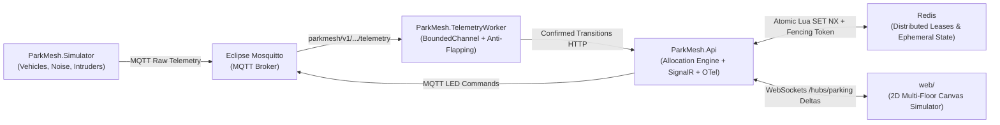

# ParkMesh Architecture Blueprint

## 1. Architectural Vision & Style

**ParkMesh** follows a **Modular Monolith + Dedicated Edge Workers** architecture built on **.NET 10 / C# 14**. Rather than introducing premature microservice serialization boundaries inside the latency-sensitive pathfinding and lease-acquisition critical path, core domain logic runs inside a single cohesive engine (`ParkMesh.Api`), while I/O-bound edge workloads (`ParkMesh.TelemetryWorker`, `ParkMesh.Simulator`) run as isolated `.NET Worker` processes communicating over MQTT and HTTP/JSON.

---

## 2. Solution Modules & Responsibilities

| Project / Directory | Layer | Primary Responsibilities |
| :--- | :--- | :--- |
| `src/ParkMesh.Domain` | Domain | Multi-floor weighted directed graph (`ParkingGraph`, `GraphNode`, `GraphEdge`, `ParkingBay`, `ParkingRoute`, `StandardTopologyFactory`), domain enums (`BayStatus`, `VehicleType`, `NodeType`, `DirectionHint`). Zero external dependencies. |
| `src/ParkMesh.Application` | Application | `AStarPathfinder` (`IPathfinder`), `ParkingAllocationService`, `IEdgeCongestionTracker`, `TelemetryIngestionChannel`, `SensorReadingFilter`, `SensorTelemetryProcessor`, `EngineMetricsRecorder` (`SlidingLatencyWindow`, OTel `Meter` & `ActivitySource`), `IParkingEventSink`. |
| `src/ParkMesh.Infrastructure` | Infrastructure | `RedisBayLeaseManager` & `LuaScripts` (atomic Redis Lua leases + monotonic fencing tokens), `InMemoryBayLeaseManager`, `MqttConnectionManager`, `MqttTelemetryHostedService`, `MqttLedPanelPublisher`, DI wiring. |
| `src/ParkMesh.Api` | Presentation / Host | Minimal APIs (`/api/parking/...`), `ParkingHub` (`/hubs/parking`), `SignalRParkingEventSink`, `MetricsBroadcastHostedService`, static serving of `web/` at `/`, OpenTelemetry tracing & metrics (`OTLP` export when `OTEL_EXPORTER_OTLP_ENDPOINT` is configured). |
| `src/ParkMesh.TelemetryWorker` | Edge Worker | Subscribes to raw MQTT sensor frames, filters chatter via `SensorTelemetryProcessor`, and forwards confirmed bay occupancy transitions via `RemoteEngineAllocationProxy`. |
| `src/ParkMesh.Simulator` | Simulator Worker | Generates concurrent vehicle arrivals, sensor flapping noise, simulated vehicle progress steps, and physical bay intrusions against MQTT + REST. |
| `web/` | Visual UI | Zero-build HTML5 Canvas 2D multi-floor renderer (`app.js`), custom SignalR JSON WebSocket client (`signalr-lite.js`), Auto-Demo loop, chaos triggers, and P50/P95/P99 telemetry HUD. |

---

## 3. Core Subsystems

### 3.1 Multi-Floor Weighted Directed Graph & A\* Pathfinding

The parking facility is modeled in memory as a weighted directed graph $G = (V, E)$ via `StandardTopologyFactory.CreateStandardGarage()` (`3` floors: `0`, `1`, `2`; `120` parking bays):

- **Vertices ($V$)**: Entry gates (`NodeType.Gate`), lane intersections (`NodeType.Intersection`), inter-floor helical ramps (`NodeType.Ramp`), and individual bays (`NodeType.Bay`).
- **Edges ($E$)**: Directed `GraphEdge` segments carrying base distance/weight (`BaseWeight`), length, lane capacity (`Capacity`), optional ramp metadata (`IsRamp`), and dynamic congestion cost adjustments via `IEdgeCongestionTracker`.
- **A\* Search (`AStarPathfinder`)**: Uses a `PriorityQueue<string, double>` with an admissible Euclidean heuristic incorporating vertical floor elevation cost, ensuring optimal shortest-cost routes while dynamically steering around congested aisles.

### 3.2 Atomic Bay Allocation, Fencing Tokens & Live Rerouting

Under high-concurrency bursts (for example 25+ vehicles arriving simultaneously at entry gates), naive read-then-write reservation logic creates race conditions and double-booked bays.

`ParkingAllocationService` + `RedisBayLeaseManager` (`LuaScripts`) eliminate split-brain allocations:

1. **Candidate Ranking**: Queries A\* cost from the vehicle's entry gate to compatible `BayStatus.Free` bays matching `VehicleType` (`Standard`, `EV`, `SUV`, `Pcd`, `Moto`).
2. **Atomic Lua Acquisition**: Executes `LuaScripts.AcquireBayLease` against `{prefix}:lease:bay:{bayId}` (`SET ... PX`) and `INCR` `{prefix}:fence:bay:{bayId}`, returning both acquisition status and a monotonic fencing token.
3. **Congestion Lock-In**: Increments live traffic load on edges along the chosen `ParkingRoute` and updates upstream LED directional panels (`DirectionHint`).
4. **Intrusion Detection & Self-Healing Reroute**: If a physical sensor reports occupancy on a bay in `BayStatus.Leased` state (an unbooked driver stole the spot), `ParkingAllocationService.ReconcilePhysicalOccupancyAsync`:
   - Marks the bay `Occupied`, revokes its active lease via fencing token check (`LuaScripts.ReleaseBayLease`), and removes stale edge congestion.
   - Locates the affected active session, computes a fresh A\* route starting from the vehicle's `CurrentNodeId`, atomically acquires a new bay lease with a higher fencing token, and emits `RouteReassigned` so both LED panels and live SignalR clients immediately redirect the driver.

### 3.3 Telemetry Ingestion Pipeline & Anti-Flapping

Physical bay sensors suffer from reflection noise, pedestrians crossing bays, and network micro-bursts.

- **Bounded Backpressure (`TelemetryIngestionChannel`)**: Uses `System.Threading.Channels.Channel.CreateBounded<BaySensorReading>` with `BoundedChannelFullMode.DropOldest`, bounding memory usage and preserving freshest physical state while tracking `StaleDroppedCount` and `EnqueuedCount`.
- **Anti-Flapping Debounce (`SensorReadingFilter`)**: Requires consecutive matching samples (`MinConsecutiveReadings`) spanning at least `StabilityWindowMs` before confirming a physical transition (`ConfirmedTransitionsCount`), preventing spurious reroute storms while counting suppressed noise (`DebouncedCount`).
- **Confirmed Edge Forwarding (`SensorTelemetryProcessor`)**: Invokes downstream allocation reconciliation only on confirmed transitions rather than steady-state heartbeats.

### 3.4 Real-Time Delta Streaming, Chaos Engineering & OpenTelemetry

- **SignalR Hub (`/hubs/parking`)**:
  - Client call: `GetParkingSnapshot()` returns full initial graph geometry, floor list, gates, active sessions, bay states, and metrics snapshot.
  - Server-to-client delta events emitted by `SignalRParkingEventSink` and `MetricsBroadcastHostedService`:
    - `RouteAssigned`
    - `RouteReassigned` (including `displacedBayId`, `displacedSessionId`, and `newSession`)
    - `BayStateChanged`
    - `VehicleMoved`
    - `LedPanelUpdated`
    - `MetricsTick` (1-second heartbeat carrying P50/P95/P99 latencies, bay counts, allocations, contention retries, reroutes, and telemetry channel counters)
- **OpenTelemetry Instrumentation (`EngineMetricsRecorder`)**:
  - `Meter("ParkMesh.Engine")`: Histograms (`parkmesh.astar.duration.ms`, `parkmesh.redis.lease.duration.ms`) and Counters (`parkmesh.allocations.total`, `parkmesh.contention.retries.total`, `parkmesh.reroutes.total`).
  - `ActivitySource("ParkMesh.Engine")`: Distributed spans around allocation (`AllocateAsync`) and physical occupancy reconciliation (`ReconcilePhysicalOccupancyAsync`).
  - Sliding-window estimator (`SlidingLatencyWindow`, capacity `1024`) exposing real-time interpolated `P50`, `P95`, and `P99` latencies without GC-heavy heap churn.

---

## 4. API & Protocol Surface

| Surface | Endpoint / Topic | Purpose |
| :--- | :--- | :--- |
| Static UI | `GET /` | Serves the 2D multi-floor HTML5 Canvas simulator (`web/index.html`) |
| Topology | `GET /api/parking/topology` | Returns graph nodes, edges, bays, and gates |
| Live Snapshot | `GET /api/parking/snapshot` | Full state + graph + metrics bootstrap payload |
| Telemetry Metrics | `GET /api/parking/metrics` | Current bay counts, active sessions, channel stats, and P50/P95/P99 |
| Allocate Route | `POST /api/parking/allocations` | Allocates optimal conflict-free route + bay lease |
| Vehicle Progress | `POST /api/parking/sessions/{sessionId}/progress` | Advances vehicle position along its assigned graph path |
| Release Session | `DELETE /api/parking/sessions/{sessionId}` | Releases lease and clears edge congestion |
| Physical Occupancy | `POST /api/parking/bays/{bayId}/occupancy` | Confirms physical occupied/vacated transition (triggers intrusion reroute if stolen) |
| Sensor Reading | `POST /api/parking/telemetry/readings` | Enqueues a raw sensor reading into `TelemetryIngestionChannel` |
| Chaos Intruder | `POST /api/parking/chaos/intruder` | Injects a physical intrusion into an active leased bay to demonstrate live rerouting |
| Chaos Burst | `POST /api/parking/chaos/burst?count=25` | Fires concurrent allocation burst across entry gates (`1..60`) |
| SignalR Hub | `WS /hubs/parking` | Bidirectional SignalR JSON protocol hub for real-time deltas |
| MQTT Sensors | `parkmesh/sensors/{floor}/{bayId}/state` | Raw ultrasonic sensor payload stream |
| MQTT Gates | `parkmesh/gates/{gateId}/admitted` | Gate vehicle admission events |
| MQTT LED Panels | `parkmesh/panels/{panelId}/direction` | Retained LED directional guidance payload |

---

## 5. Architecture Decision Records

Key technical trade-offs are documented in `docs/adr/`:

1. [ADR 0001 — Modular Monolith with Dedicated Edge Workers](adr/0001-modular-monolith-over-microservices.md)
2. [ADR 0002 — Atomic Redis Lua Leases with Monotonic Fencing Tokens](adr/0002-redis-lua-leases-with-fencing-tokens.md)
3. [ADR 0003 — Multi-Floor A\* Pathfinding with Admissible Euclidean Heuristic](adr/0003-multi-floor-astar-with-admissible-heuristic.md)
4. [ADR 0004 — Bounded Channel Backpressure and Anti-Flapping Debounce](adr/0004-bounded-channel-backpressure-and-anti-flapping.md)
5. [ADR 0005 — SignalR Delta Protocol and Zero-Build HTML5 Canvas Simulator](adr/0005-signalr-delta-protocol-and-zero-build-canvas.md)
